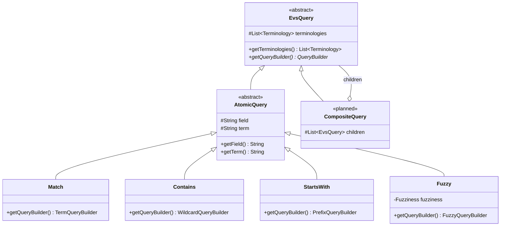

# EVS Query Tree

This package models a concept search as a tree of small query objects. Each node turns itself into
an OpenSearch `QueryBuilder`. Behavior is chosen by which classes you put in the tree (dynamic
dispatch), not by switching on a `type` string as `OpenSearchServiceImpl.getTermQuery` does.

- **Atomic queries** are the leaves. Each one matches a single field using a single strategy.
- **Composite queries** (planned) combine other queries with `and`, `or`, and so on.

Because every node has the same interface, any query can be nested inside any composite:

```lisp
(and (fuzzy  "normName" "melanoma")
     (or (match       "code"     "C3224")
         (starts-with "normName" "blood")))
```

## Hierarchy



| Class | Role |
|---|---|
| `EvsQuery` | Base type for every node. Its contract is `getQueryBuilder()`. It also holds an unmodifiable copy of the terminologies being searched. Code that accepts a query should accept `EvsQuery`, so leaves and composites can be used interchangeably. |
| `AtomicQuery` | Base type for leaves. It adds the `field` and `term` every leaf needs and rejects `null` for either. Subclasses only decide which OpenSearch query to build. |
| `CompositeQuery` | Not implemented yet. A composite holds child `EvsQuery` nodes instead of a field and a term. |

## Atomic queries

All atomic queries are **case sensitive** and compare against the **whole indexed value**.

| Class | Matches when the value… | OpenSearch query |
|---|---|---|
| `Match` | equals the term exactly | `term` |
| `Contains` | includes the term anywhere | `wildcard` on `*term*`, with `*`, `?`, and `\` in the term escaped |
| `StartsWith` | begins with the term | `prefix` |
| `Fuzzy` | is within a small edit distance of the term (`Fuzziness.AUTO` by default, or pass one) | `fuzzy` |

### Choosing a field

Whole-value matching only works on `Keyword` fields. On an analyzed `Text` field such as `name`,
OpenSearch stores lowercased tokens, so these queries match individual words instead of the full
value.

Today **no field stores concept or synonym names in their original case**:

- `name` and `synonyms.name` are `Text`, so they're tokenized and lowercased.
- `normName` and `synonyms.normName` are `Keyword`, but `ConceptUtils.normalize` lowercases them
  and strips punctuation first.

So against current indexes, `Match`, `Contains`, and the others are effectively case insensitive
on `normName`, and the term should be normalized the same way. True case-sensitive name matching
needs a keyword subfield (e.g. `name.keyword` via `@MultiField`, as `Mapping.source` does) and a
reindex.

Fields under `synonyms`, `definitions`, and `properties` are nested. Queries on them must be
wrapped in a `nestedQuery`, which is a natural job for a future `Nested` composite.

### Usage

```java
final EvsQuery query = new StartsWith(terminologies, "normName", "melan");
boolQuery.must(query.getQueryBuilder());
```

## Extending

### Adding an atomic query

Extend `AtomicQuery`, pass the constructor arguments through, and build the OpenSearch query from
`field` and `term`. For example, a regular-expression leaf:

```java
package gov.nih.nci.evs.api.query;

import gov.nih.nci.evs.api.model.Terminology;
import java.util.List;
import org.opensearch.index.query.QueryBuilder;
import org.opensearch.index.query.QueryBuilders;

/** Matches values against a regular expression (case sensitive). */
public class Regex extends AtomicQuery {

  /**
   * Instantiates a {@link Regex}.
   *
   * @param terminologies the terminologies being searched
   * @param field the field to match against
   * @param term the regular expression the value must match
   */
  public Regex(final List<Terminology> terminologies, final String field, final String term) {
    super(terminologies, field, term);
  }

  /* see superclass */
  @Override
  public QueryBuilder getQueryBuilder() {
    return QueryBuilders.regexpQuery(field, term);
  }
}
```

### Adding a composite query

Extend `EvsQuery` directly. A composite holds child nodes and combines their builders. It never
needs to know which concrete classes its children are. For example, `And`:

```java
package gov.nih.nci.evs.api.query;

import gov.nih.nci.evs.api.model.Terminology;
import java.util.List;
import org.opensearch.index.query.BoolQueryBuilder;
import org.opensearch.index.query.QueryBuilder;
import org.opensearch.index.query.QueryBuilders;

/** Matches when every child query matches. */
public class And extends EvsQuery {

  /** The child queries. */
  private final List<EvsQuery> children;

  /**
   * Instantiates an {@link And}.
   *
   * @param terminologies the terminologies being searched
   * @param children the queries that must all match
   */
  public And(final List<Terminology> terminologies, final List<EvsQuery> children) {
    super(terminologies);
    this.children = List.copyOf(children);
  }

  /* see superclass */
  @Override
  public QueryBuilder getQueryBuilder() {
    final BoolQueryBuilder boolQuery = QueryBuilders.boolQuery();
    for (final EvsQuery child : children) {
      boolQuery.must(child.getQueryBuilder());
    }
    return boolQuery;
  }
}
```

`Or` is the same with `should(...)` and `minimumShouldMatch(1)`. `Not` uses `mustNot(...)`.

Composites nest without any extra code:

```java
final EvsQuery query =
    new And(
        terminologies,
        List.of(
            new Fuzzy(terminologies, "normName", "melanoma"),
            new Or(
                terminologies,
                List.of(
                    new Match(terminologies, "code", "C3224"),
                    new StartsWith(terminologies, "normName", "blood")))));
```

### Checklist for a new query

1. Name it after what it matches, and document that behavior in the class Javadoc.
2. Build an OpenSearch query in `getQueryBuilder()`. Don't run searches or read services there.
3. Escape any characters in the term that are syntax for the OpenSearch query you use (see
   `Contains.escapeWildcards`).
4. Add tests to `src/test/java/gov/nih/nci/evs/api/query` that assert on the built query. The
   query builders expose their settings, so no OpenSearch instance is needed.
5. Run `./gradlew spotlessApply`.
