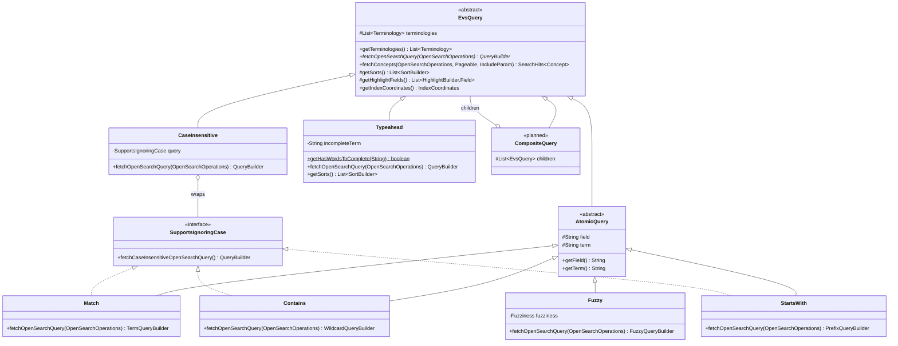

# EVS Query Tree

This package models a concept search as a tree of small query objects. Each node turns itself into
an OpenSearch `QueryBuilder`. Behavior is chosen by which classes you put in the tree (dynamic
dispatch), not by switching on a `type` string as `OpenSearchServiceImpl.getTermQuery` does.

- **Atomic queries** are the leaves. Each one matches a single field using a single strategy.
- **Composite queries** (planned) combine other queries with `and`, `or`, and so on.

Because every node has the same interface, any query can be nested inside any composite:

```lisp
(and (fuzzy  "normName" "melanoma")
     (or (match       "code"     "C3224")
         (starts-with "normName" "blood")))
```

## Hierarchy



| Class | Role |
|---|---|
| `EvsQuery` | Base type for every node. Its contract is `fetchOpenSearchQuery(operations)`. It also holds an unmodifiable copy of the terminologies being searched, and (experimental, see [Sorting](#sorting-experimental)) contributes sorts and builds a whole search request. Code that accepts a query should accept `EvsQuery`, so leaves and composites can be used interchangeably. |
| `AtomicQuery` | Base type for leaves. It adds the `field` and `term` every leaf needs and rejects `null` for either. Subclasses only decide which OpenSearch query to build. |
| `SupportsIgnoringCase` | Implemented by queries that can also run ignoring case: `Match`, `StartsWith`, and `Contains`. `Fuzzy` doesn't, because OpenSearch has no case-insensitive fuzzy query. |
| `CaseInsensitive` | A wrapper node. It runs the wrapped query ignoring case by calling `fetchCaseInsensitiveOpenSearchQuery()`. The wrapped query is not changed. |
| `Typeahead` | The query behind `/concept/typeahead`. Matches preferred names with `SearchAsYouType` (on `name.search_as_you_type`), and codes case sensitively with `Match` (whole code) and `StartsWith` (partial code) on `code`, leaving out concepts with `active: false`, and overrides `getSorts()` to sort matches into tiers (a whole typed code, then name matches, then code-only matches) and rank general concepts with short names first within a tier. It ranks on the `descendantCount` field stored at load time, falling back to counting `descendants.leaf` on indexes loaded before that field existed. The count is the size of the stored `descendants`, so the SNOMED root (`138875005`), whose descendants the loader skips, has a count of 0 and ranks like a leaf. `Typeahead.getHasWordsToComplete(term)` says whether a term has anything to complete; the constructor rejects terms that don't. The endpoint's `total` stops at 10,000 (OpenSearch's default count limit): typeahead doesn't page, so unlike search it doesn't run a second query for the exact count. `SearchControllerTests.testTypeaheadTotalCapsAtCountedHitLimit` pins this. Highlighting is optional: the endpoint takes an `include` parameter like search (default `minimal`). With `include=minimal,highlights`, `fetchConcepts` asks OpenSearch to highlight the matched fields, and the endpoint returns OpenSearch's highlight of each suggestion's name (or of its code, if only the code matched). OpenSearch marks whole words: `lung ca` gives `<em>Lung</em> <em>Carcinoma</em>`. Typeahead overrides `getHighlightFields()` to highlight the main `name` field with a `match_bool_prefix` highlight query, because highlighting the `search_as_you_type` subfield it matched never marks the partial last word (and `*` doesn't reach subfields at all). `TypeaheadTest` lesson 10, `SearchControllerTests.testTypeaheadNameMatchHighlightsTypedWords`, `...testTypeaheadCodeMatchHighlightsCode`, `...testTypeaheadEndpointDefaultIncludeReturnsNoHighlights`, and `...testTypeaheadEndpointHighlightsIncludeReturnsHighlights` pin this. |
| `CompositeQuery` | Not implemented yet. A composite holds child `EvsQuery` nodes instead of a field and a term. |

## Atomic queries

Apart from `SearchAsYouType`, the atomic queries are **case sensitive** and compare against the
**whole indexed value**. To ignore case, wrap one in `CaseInsensitive` (see below).
`SearchAsYouType` works on individual words and always ignores case.

| Class | Matches when the value… | OpenSearch query |
|---|---|---|
| `Match` | equals the term exactly | `term` |
| `Contains` | includes the term anywhere | `wildcard` on `*term*`, with `*`, `?`, and `\` in the term escaped |
| `StartsWith` | begins with the term | `prefix` |
| `Fuzzy` | is within a small edit distance of the term (`Fuzziness.AUTO` by default, or pass one) | `fuzzy` |
| `SearchAsYouType` | contains every typed word in any order, with only the last word allowed to be partial. Ignores case. Needs a field mapped as `search_as_you_type` | `multi_match` of type `bool_prefix` over the field and its `._2gram` / `._3gram` subfields |

### Choosing a field

Whole-value matching only works on `Keyword` fields. On an analyzed `Text` field such as `name`,
OpenSearch stores lowercased tokens, so these queries match individual words instead of the full
value.

Today **no field stores concept or synonym names in their original case**:

- `name` and `synonyms.name` are `Text`, so they're tokenized and lowercased.
- `normName` and `synonyms.normName` are `Keyword`, but `ConceptUtils.normalize` lowercases them
  and strips punctuation first.

So against current indexes, `Match`, `Contains`, and the others are effectively case insensitive
on `normName`, and the term should be normalized the same way. True case-sensitive name matching
needs a keyword subfield (e.g. `name.keyword` via `@MultiField`, as `Mapping.source` does) and a
reindex.

Fields under `synonyms`, `definitions`, and `properties` are nested. Queries on them must be
wrapped in a `nestedQuery`, which is a natural job for a future `Nested` composite.

### Usage

```java
final EvsQuery query = new StartsWith(terminologies, "normName", "melan");
boolQuery.must(query.fetchOpenSearchQuery(operations));
```

## Ignoring case

`CaseInsensitive` wraps a query that implements `SupportsIgnoringCase`:

```java
// Finds "Melanoma", "melanoma", and "Malignant Melanoma"
final EvsQuery query =
    new CaseInsensitive(new Contains(terminologies, "name", "MELANOMA"));
```

The constructor only accepts queries that implement `SupportsIgnoringCase`, so
`new CaseInsensitive(new Fuzzy(...))` doesn't compile. To let a new query be wrapped, implement
`SupportsIgnoringCase` and return the same OpenSearch query with case ignored, usually by calling
`.caseInsensitive(true)` on the builder.

## Sorting (experimental)

> **Experimental** (branch `eas/typeahead-composed-sorts`). This lets query nodes contribute
> sorts that compose by priority. If it turns out not to fit, go back to commit `5765d1eb`, where
> `Typeahead` supplied its sorts and `OpenSearchServiceImpl` built the request. The alternatives
> considered were ranking through the score (`script_score` / `rank_feature`, which blends across
> branches) and a separate top-level sort object (an `EvsSort` tree passed alongside the query).

Any node can be run as the outermost query of a search, one page at a time:

```java
final SearchHits<Concept> hits = query.fetchConcepts(operations, pageable, include);
```

The request's sort order comes from `getSorts()`. Most nodes only match and return no sorts.
`Typeahead` returns its ranking sort. The rules:

1. **A node's own sorts come first, then each child's sorts in child order.** Composites must
   implement `getSorts()` this way. A nested node's sorts therefore only break ties left by the
   nodes above and before it, like `ORDER BY a, b, c` in SQL. `And(a, b)` and `And(b, a)` match the
   same concepts but can order them differently.
2. **Negating composites contribute nothing.** A `Not` returns none of its children's sorts.
3. **Duplicates are dropped.** The first occurrence of a sort keeps its position.
4. **`fetchConcepts` always appends the tie-break `_index`, then `code`.** Each terminology
   has its own index, so this orders by terminology, then code, and results are stable between
   requests. (`terminology` is analyzed text and can't be sorted on.)

Known limits:

- **A sort ranks every hit, not just the hits its node matched.** Under `And`, every hit matched
  every child, so this doesn't come up. Under `Or`, a child's sort also orders hits that only its
  sibling matched. Script sorts like `Typeahead`'s work on any concept. Field sorts put documents
  missing the field last.
- **There's no way to replace the tree's sorts yet,** for example with a user-chosen "name A to Z".
  Add an override parameter to `fetchConcepts` when one is needed.
- **Sorts can't blend.** A higher-priority sort always wins outright. Blending relevance across
  branches needs ranking through the score instead.

## Queries about other concepts (joins)

Some nodes hold a query that describes a different concept than the one being matched. For
example, a role's target: "primary site is Skin or anything below Skin" (spec 1.4). One OpenSearch
query only looks at one document, and a role entry only stores its target's code, so such a node
can't become one OpenSearch query.

**How it works:** building such a node runs the inner query first. `fetchOpenSearchQuery(operations)`
takes the OpenSearch operations so it can. The node calls `declareDependencies(operations,
dependencies...)`, which runs each dependency and pages through every matching concept with
`search_after` (sorted by code, then index, so pages don't overlap), fetching only each concept's
code, terminology, and version. It returns one `ConceptKeys` per dependency: the codes found in
each terminology version. The node then matches what it found, e.g. with a `terms` query on codes.
The paging itself is private to `EvsQuery`. An inner query can hold its own query about another
concept, which runs first in the same way, to any depth. Nodes that don't hold a query about
another concept ignore `operations`.

**Why `operations` is a parameter:** a static lookup hides which nodes search and makes tests
change global state; injecting it at construction means every tree containing a search needs it
just to be built. Taking it in `fetchOpenSearchQuery` keeps trees plain data, and lets unit tests pass a
mock (see `DeclareDependenciesTest`).

**Limits are the caller's:** how many codes the caller can match (one `terms` query accepts at most
65,536 by default) depends on how it uses them, so the node that matches them checks, not the
fetch.

## Extending

### Adding an atomic query

Extend `AtomicQuery`, pass the constructor arguments through, and build the OpenSearch query from
`field` and `term`. For example, a regular-expression leaf:

```java
package gov.nih.nci.evs.api.query;

import gov.nih.nci.evs.api.model.Terminology;
import java.util.List;
import org.opensearch.index.query.QueryBuilder;
import org.opensearch.index.query.QueryBuilders;

/** Matches values against a regular expression (case sensitive). */
public class Regex extends AtomicQuery {

  /**
   * Instantiates a {@link Regex}.
   *
   * @param terminologies the terminologies being searched
   * @param field the field to match against
   * @param term the regular expression the value must match
   */
  public Regex(final List<Terminology> terminologies, final String field, final String term) {
    super(terminologies, field, term);
  }

  /* see superclass */
  @Override
  public QueryBuilder fetchOpenSearchQuery(final OpenSearchOperations operations) {
    return QueryBuilders.regexpQuery(field, term);
  }
}
```

### Adding a composite query

Extend `EvsQuery` directly. A composite holds child nodes and combines their builders. It never
needs to know which concrete classes its children are. For example, `And`:

```java
package gov.nih.nci.evs.api.query;

import gov.nih.nci.evs.api.model.Terminology;
import java.util.List;
import org.opensearch.index.query.BoolQueryBuilder;
import org.opensearch.index.query.QueryBuilder;
import org.opensearch.index.query.QueryBuilders;

/** Matches when every child query matches. */
public class And extends EvsQuery {

  /** The child queries. */
  private final List<EvsQuery> children;

  /**
   * Instantiates an {@link And}.
   *
   * @param terminologies the terminologies being searched
   * @param children the queries that must all match
   */
  public And(final List<Terminology> terminologies, final List<EvsQuery> children) {
    super(terminologies);
    this.children = List.copyOf(children);
  }

  /* see superclass */
  @Override
  public QueryBuilder fetchOpenSearchQuery(final OpenSearchOperations operations) {
    final BoolQueryBuilder boolQuery = QueryBuilders.boolQuery();
    for (final EvsQuery child : children) {
      boolQuery.must(child.fetchOpenSearchQuery(operations));
    }
    return boolQuery;
  }
}
```

`Or` is the same with `should(...)` and `minimumShouldMatch(1)`. `Not` uses `mustNot(...)`.

Composites nest without any extra code:

```java
final EvsQuery query =
    new And(
        terminologies,
        List.of(
            new Fuzzy(terminologies, "normName", "melanoma"),
            new Or(
                terminologies,
                List.of(
                    new Match(terminologies, "code", "C3224"),
                    new StartsWith(terminologies, "normName", "blood")))));
```

### Checklist for a new query

1. Name it after what it matches, and document that behavior in the class Javadoc.
2. Build an OpenSearch query in `fetchOpenSearchQuery(operations)`. Only run a search there for a query
   about another concept, through `declareDependencies` (see
   [Queries about other concepts](#queries-about-other-concepts-joins)).
3. Escape any characters in the term that are syntax for the OpenSearch query you use (see
   `Contains.escapeWildcards`).
4. If the OpenSearch query supports ignoring case, implement `SupportsIgnoringCase`.
5. Add a lesson to `AtomicQueryTest` (or a similar test) that runs the query against the test index
   and asserts which values it finds. Test behavior, not the built `QueryBuilder`.
6. Run `./gradlew spotlessApply`.
