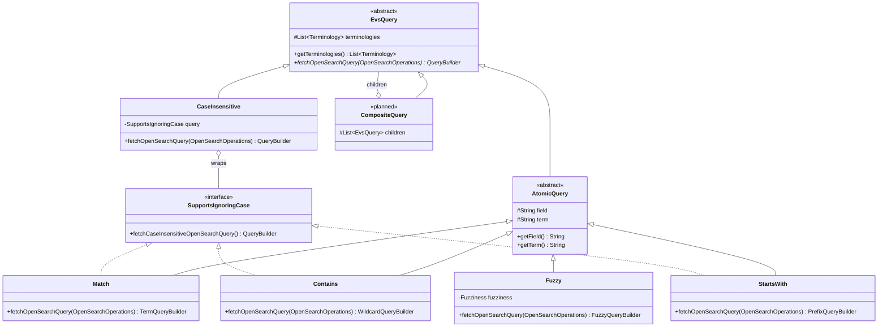

# EVS Query Tree

This package models a concept search as a tree of small query objects. Each node turns itself into
an OpenSearch `QueryBuilder`. Behavior is chosen by which classes you put in the tree (dynamic
dispatch), not by switching on a `type` string as `OpenSearchServiceImpl.getTermQuery` does.

- **Atomic queries** are the leaves. Each one matches a single field using a single strategy.
- **Composite queries** (planned) combine other queries with `and`, `or`, and so on.

Because every node has the same interface, any query can be nested inside any composite:

```lisp
(and (fuzzy  "normName" "melanoma")
     (or (match       "code"     "C3224")
         (starts-with "normName" "blood")))
```

## Logical operators: use raw OpenSearch for now

The plan is to build queries almost entirely from logical operator nodes (`And`, `Or`, `Not`,
`Boost`, and similar), with raw OpenSearch `QueryBuilder`s only inside the atomic leaves. Those
nodes exist on a separate branch but **aren't tested yet, so don't build on them.**

Until they land, combine conditions inside your node's `fetchOpenSearchQuery` with raw OpenSearch
(`QueryBuilders.boolQuery()`, `nestedQuery`, `constantScoreQuery`, ...). Expect that code to be
refactored onto the logical nodes later. To keep that refactor mechanical:

- Build leaf conditions with the atomic nodes (`Match`, `StartsWith`, ...) and call their
  `fetchOpenSearchQuery`, rather than writing `termQuery`/`prefixQuery` by hand.
- Keep the raw combining code (`bool`, `must`, `should`, `must_not`, `constant_score`) in small,
  clearly named helpers, so each one maps onto a single logical node.

## Hierarchy



| Class | Role |
|---|---|
| `EvsQuery` | Base type for every node. Its contract is `fetchOpenSearchQuery(operations)`. It also holds an unmodifiable copy of the terminologies being searched. Code that accepts a query should accept `EvsQuery`, so leaves and composites can be used interchangeably. |
| `AtomicQuery` | Base type for leaves. It adds the `field` and `term` every leaf needs and rejects `null` for either. Subclasses only decide which OpenSearch query to build. |
| `SupportsIgnoringCase` | Implemented by queries that can also run ignoring case: `Match`, `StartsWith`, and `Contains`. `Fuzzy` doesn't, because OpenSearch has no case-insensitive fuzzy query. |
| `CaseInsensitive` | A wrapper node. It runs the wrapped query ignoring case by calling `fetchCaseInsensitiveOpenSearchQuery()`. The wrapped query is not changed. |
| `CompositeQuery` | Not implemented yet. A composite holds child `EvsQuery` nodes instead of a field and a term. |

## Atomic queries

Apart from `SearchAsYouType`, the atomic queries are **case sensitive** and compare against the
**whole indexed value**. To ignore case, wrap one in `CaseInsensitive` (see below).
`SearchAsYouType` works on individual words and always ignores case.

| Class | Matches when the value… | OpenSearch query |
|---|---|---|
| `Match` | equals the term exactly | `term` |
| `Contains` | includes the term anywhere | `wildcard` on `*term*`, with `*`, `?`, and `\` in the term escaped |
| `StartsWith` | begins with the term | `prefix` |
| `Fuzzy` | is within a small edit distance of the term (`Fuzziness.AUTO` by default, or pass one) | `fuzzy` |
| `SearchAsYouType` | contains every typed word in any order, with only the last word allowed to be partial. Ignores case. Needs a field mapped as `search_as_you_type` | `multi_match` of type `bool_prefix` over the field and its `._2gram` / `._3gram` subfields |

### Choosing a field

Whole-value matching only works on `Keyword` fields. On an analyzed `Text` field such as `name`,
OpenSearch stores lowercased tokens, so these queries match individual words instead of the full
value.

Today **no field stores concept or synonym names in their original case**:

- `name` and `synonyms.name` are `Text`, so they're tokenized and lowercased.
- `normName` and `synonyms.normName` are `Keyword`, but `ConceptUtils.normalize` lowercases them
  and strips punctuation first.

So against current indexes, `Match`, `Contains`, and the others are effectively case insensitive
on `normName`, and the term should be normalized the same way. True case-sensitive name matching
needs a keyword subfield (e.g. `name.keyword` via `@MultiField`, as `Mapping.source` does) and a
reindex.

Fields under `synonyms`, `definitions`, and `properties` are nested. Queries on them must be
wrapped in a `nestedQuery`, which is a natural job for a future `Nested` composite.

### Usage

```java
final EvsQuery query = new StartsWith(terminologies, "normName", "melan");
boolQuery.must(query.fetchOpenSearchQuery(operations));
```

## Ignoring case

`CaseInsensitive` wraps a query that implements `SupportsIgnoringCase`:

```java
// Finds "Melanoma", "melanoma", and "Malignant Melanoma"
final EvsQuery query =
    new CaseInsensitive(new Contains(terminologies, "name", "MELANOMA"));
```

The constructor only accepts queries that implement `SupportsIgnoringCase`, so
`new CaseInsensitive(new Fuzzy(...))` doesn't compile. To let a new query be wrapped, implement
`SupportsIgnoringCase` and return the same OpenSearch query with case ignored, usually by calling
`.caseInsensitive(true)` on the builder.

## Queries about other concepts (joins)

Some nodes hold a query that describes a *different* concept from the one being matched:

- `HasRole`'s target: "primary site is Skin or anything below Skin" (spec 1.4)
- Planned: `HasAssociation`'s target (1.5), and `Reachable`'s seeds and hops (1.11)

OpenSearch can't join across documents. A nested query only reaches inside the same concept
document, and a role entry only stores its target's code. So
`HasRole(type, Or(Match(code, Skin), DescendantOf(Skin)))` can't become one OpenSearch query.

**How it works:** building such a node runs the inner query first. `fetchOpenSearchQuery(operations)`
takes the OpenSearch operations, and `HasRole` calls `declareDependencies(operations,
roleTarget.getQuery())`. That pages through every matching concept with `search_after` (privately,
inside `EvsQuery`), fetching only each concept's code, terminology, and version, and returns a
`ConceptKeys`: the codes found in each terminology version. For each terminology version, `HasRole` matches concepts from that terminology version
with a role entry pointing to one of its codes. An inner query can hold its own role target, which
runs first in the same way, to any depth. Nodes that don't hold a query about another concept ignore
`operations`.

**Why codes are matched per terminology version:** a code alone doesn't identify a concept. Two
versions of a terminology share codes, and a role's target code refers to a concept in the role's
own terminology version. So a target found in one version must only match roles on concepts from
that version. `HasRole` filters on the exact `terminology.keyword` and `version.keyword` subfields
(the main `terminology` and `version` fields are analyzed text). The filter sits outside the
`nested` roles query, because a nested query only sees the role entry's own fields.

**Why `operations` is a parameter:** a static lookup hides which nodes search and makes tests
change global state; injecting it at construction means every tree containing a search needs it
just to be built. Taking it in `fetchOpenSearchQuery` keeps trees plain data, and lets unit tests pass a
mock (see `DeclareDependenciesTest`).

**Why the inner query always runs first:** handing codes between searches is cheap. On local NCIt
25.12e, OpenSearch ran a `terms` query over about 23,000 codes in 80ms. A plan that starts from the
other side of the join could sometimes pass fewer codes, but it isn't worth a planner. The
benchmark, and the SPARQL (Fuseki) comparison, is written up under 1.4 Role in the project notes.

**Limit:** one `terms` query accepts at most 65,536 codes (OpenSearch's default
`index.max_terms_count`). A role target matching more concepts in one terminology version fails with
an `IllegalStateException`, instead of cutting the codes short and silently returning wrong results.

**Reindex:** `terminology.keyword` and `version.keyword` are new subfields, and `roles` is now
nested. Existing concept indexes have neither, so `HasRole` needs a reindex.

## Extending

### Adding an atomic query

Extend `AtomicQuery`, pass the constructor arguments through, and build the OpenSearch query from
`field` and `term`. For example, a regular-expression leaf:

```java
package gov.nih.nci.evs.api.query;

import gov.nih.nci.evs.api.model.Terminology;
import java.util.List;
import org.opensearch.index.query.QueryBuilder;
import org.opensearch.index.query.QueryBuilders;

/** Matches values against a regular expression (case sensitive). */
public class Regex extends AtomicQuery {

  /**
   * Instantiates a {@link Regex}.
   *
   * @param terminologies the terminologies being searched
   * @param field the field to match against
   * @param term the regular expression the value must match
   */
  public Regex(final List<Terminology> terminologies, final String field, final String term) {
    super(terminologies, field, term);
  }

  /* see superclass */
  @Override
  public QueryBuilder fetchOpenSearchQuery(final OpenSearchOperations operations) {
    return QueryBuilders.regexpQuery(field, term);
  }
}
```

### Adding a composite query

> Don't add `And`, `Or`, `Not`, or similar yourself: they're coming from a separate branch (see
> [Logical operators](#logical-operators-use-raw-opensearch-for-now)). This section describes how
> composites are meant to work.

Extend `EvsQuery` directly. A composite holds child nodes and combines their builders. It never
needs to know which concrete classes its children are. For example, `And`:

```java
package gov.nih.nci.evs.api.query;

import gov.nih.nci.evs.api.model.Terminology;
import java.util.List;
import org.opensearch.index.query.BoolQueryBuilder;
import org.opensearch.index.query.QueryBuilder;
import org.opensearch.index.query.QueryBuilders;

/** Matches when every child query matches. */
public class And extends EvsQuery {

  /** The child queries. */
  private final List<EvsQuery> children;

  /**
   * Instantiates an {@link And}.
   *
   * @param terminologies the terminologies being searched
   * @param children the queries that must all match
   */
  public And(final List<Terminology> terminologies, final List<EvsQuery> children) {
    super(terminologies);
    this.children = List.copyOf(children);
  }

  /* see superclass */
  @Override
  public QueryBuilder fetchOpenSearchQuery(final OpenSearchOperations operations) {
    final BoolQueryBuilder boolQuery = QueryBuilders.boolQuery();
    for (final EvsQuery child : children) {
      boolQuery.must(child.fetchOpenSearchQuery(operations));
    }
    return boolQuery;
  }
}
```

`Or` is the same with `should(...)` and `minimumShouldMatch(1)`. `Not` uses `mustNot(...)`.

Composites nest without any extra code:

```java
final EvsQuery query =
    new And(
        terminologies,
        List.of(
            new Fuzzy(terminologies, "normName", "melanoma"),
            new Or(
                terminologies,
                List.of(
                    new Match(terminologies, "code", "C3224"),
                    new StartsWith(terminologies, "normName", "blood")))));
```

### Checklist for a new query

1. Name it after what it matches, and document that behavior in the class Javadoc.
2. Build an OpenSearch query in `fetchOpenSearchQuery(operations)`. Only run a search there for a query
   about another concept, through `declareDependencies` (see
   [Queries about other concepts](#queries-about-other-concepts-joins)).
3. Escape any characters in the term that are syntax for the OpenSearch query you use (see
   `Contains.escapeWildcards`).
4. If the OpenSearch query supports ignoring case, implement `SupportsIgnoringCase`.
5. Add a lesson to `AtomicQueryTest` (or a similar test) that runs the query against the test index
   and asserts which values it finds. Test behavior, not the built `QueryBuilder`.
6. Run `./gradlew spotlessApply`.
