# EVS Query Tree

This package models a concept search as a tree of small query objects. Each node turns itself into
an OpenSearch `QueryBuilder`. Behavior is chosen by which classes you put in the tree (dynamic
dispatch), not by switching on a `type` string as `OpenSearchServiceImpl.getTermQuery` does.

Every node is an `EvsQuery` and says which concepts match. There are three kinds:

- **Term searches** (`TermSearch`: `Exact`, `StartsWith`, `Contains`, `Fuzzy`) search a
  concept's name, code, and synonyms for a term, the way the legacy `GET /concept/search` does for
  that `type`, and rank by relevance.
- **Field nodes** (`HasProperty`, `HasSynonym`, `HasRole`, `InSubset`, `HasAncestor`, ...) match
  names, codes, and values stored on the concept. Each value is a plain `String`, compared exactly.
- **Logical queries** (`And`, `Or`, `Not`, and the `Boost` wrapper) combine other queries.

`MatchAnyOf` (one field equal to any of a set of values) and `NameOrCodeMatch` (a name field or a
code field equal to any of a set of names or codes) are the leaves nodes are built from. They're
package-private, not part of the API: tests showing how to use the API, like `HasRoleTest`, stick
to the public nodes.

Because every query has the same interface, any query can be nested inside any composite:

```lisp
(and (fuzzy "melanoma")
     (or (exact "C3224")
         (starts-with "blood")))
```

## Logical operators: exploratory on this branch

The plan is to build queries almost entirely from logical operator nodes (`And`, `Or`, `Not`,
`Boost`, and similar), with raw OpenSearch `QueryBuilder`s only inside the leaf nodes. On the
exploratory branch `eas/explore-filters` they're merged in from `eas/logical-operators` and can be
used to combine nodes (see [Logical queries](#logical-queries)). They're still only tested by
`LogicalQueryTest` and the lessons that use them, so on other branches don't build on them yet.

Inside a node's own `fetchOpenSearchQuery`, existing nodes still combine conditions with raw
OpenSearch (`QueryBuilders.boolQuery()`, `nestedQuery`, `constantScoreQuery`, ...), e.g. a
property's type and value on one nested entry, which the concept-level logical nodes can't
express. Expect the rest to be refactored onto the logical nodes later. To keep that mechanical:

- Build leaf conditions with `MatchAnyOf` (or `NameOrCodeMatch` for a name or code) and call its
  `fetchOpenSearchQuery`, rather than writing `termQuery`/`termsQuery` by hand.
- Keep the raw combining code (`bool`, `must`, `should`, `must_not`, `constant_score`) in small,
  clearly named helpers, so each one maps onto a single logical node.

## Hierarchy

```mermaid
classDiagram
    direction TB

    class EvsQuery {
        <<abstract>>
        +fetchOpenSearchQuery(OpenSearchOperations, List~Terminology~)* QueryBuilder
        +fetchConcepts(OpenSearchOperations, List~Terminology~, Pageable, IncludeParam) SearchHits~Concept~
        #getSorts() List~SortBuilder~
        #getHighlightFields() List~HighlightBuilder.Field~
        +getIndexCoordinates(List~Terminology~)$ IndexCoordinates
    }

    class TermSearch {
        <<abstract>>
        -String term
        #getTermQuery(String escapedTerm)* QueryBuilder
        #getSorts() List~SortBuilder~
    }
    class Exact
    class StartsWith
    class Contains
    class Fuzzy

    class HasRelationship {
        <<abstract>>
        -String relationshipType
        -String target
        #getRelationshipType() String
        #getRelationshipListFieldName()* String
    }

    class InSubset {
        -String target
    }

    class HasProperty {
        -String property
        -String target
        -QualifierCondition qualifiers
    }

    class HasSynonym {
        -String target
        -String source
        -String termType
        -String subSource
    }

    class QualifierCondition {
        <<interface>>
        +getPropertiesMatching(String, OpenSearchOperations, List~Terminology~) QueryBuilder
    }
    class AllQualifiers {
        -List~QualifierCondition~ conditions
    }
    class AnyQualifiers {
        -List~QualifierCondition~ conditions
    }
    class NoQualifiers {
        -QualifierCondition condition
    }
    class PropertyQualifier {
        -String qualifier
        -String target
    }

    class And {
        -List~EvsQuery~ children
    }
    class Or {
        -List~EvsQuery~ children
    }
    class Not {
        -EvsQuery child
    }
    class Boost {
        -EvsQuery child
        -float score
    }

    class Typeahead {
        -String term
        +getHasWordsToComplete(String)$ boolean
        +fetchOpenSearchQuery(OpenSearchOperations, List~Terminology~) QueryBuilder
        +getSorts() List~SortBuilder~
    }

    class MatchAnyOf {
        -String field
        -Set~String~ values
        +fetchOpenSearchQuery(OpenSearchOperations, List~Terminology~) TermsQueryBuilder
    }
    class NameOrCodeMatch {
        -String nameField
        -String codeField
        -Set~String~ namesOrCodes
    }

    class HasHierarchyRelative {
        <<abstract>>
        -String target
        -Integer maxLevel
        #fetchTargetCodes(OpenSearchOperations, Terminology) Set~String~
        #fetchRelativesQuery(OpenSearchOperations, Terminology, Set~String~)* QueryBuilder
    }
    class HasAncestor
    class HasAncestorOrIs {
        +fetchOpenSearchQuery(OpenSearchOperations, List~Terminology~) QueryBuilder
    }
    class HasDescendant
    class HasDescendantOrIs {
        +fetchOpenSearchQuery(OpenSearchOperations, List~Terminology~) QueryBuilder
    }

    EvsQuery <|-- TermSearch
    TermSearch <|-- Exact
    TermSearch <|-- StartsWith
    TermSearch <|-- Contains
    TermSearch <|-- Fuzzy
    EvsQuery <|-- HasRelationship
    EvsQuery <|-- HasProperty
    EvsQuery <|-- Typeahead
    EvsQuery <|-- And
    EvsQuery <|-- Or
    EvsQuery <|-- Not
    EvsQuery <|-- Boost
    EvsQuery <|-- HasSynonym
    HasRelationship <|-- HasRole
    HasRelationship <|-- HasAssociation
    HasRelationship <|-- HasInverseRole
    HasRelationship <|-- HasInverseAssociation
    EvsQuery <|-- InSubset
    InSubset ..> Or : builds
    InSubset ..> HasAssociation : builds
    And o-- EvsQuery : children
    Or o-- EvsQuery : children
    Not o-- EvsQuery : child
    Boost o-- EvsQuery : child
    HasProperty o-- QualifierCondition : qualifiers
    QualifierCondition <|.. PropertyQualifier
    QualifierCondition <|.. AllQualifiers
    QualifierCondition <|.. AnyQualifiers
    QualifierCondition <|.. NoQualifiers
    AllQualifiers o-- QualifierCondition : conditions
    AnyQualifiers o-- QualifierCondition : conditions
    NoQualifiers o-- QualifierCondition : condition
    EvsQuery <|-- MatchAnyOf
    EvsQuery <|-- NameOrCodeMatch
    NameOrCodeMatch ..> MatchAnyOf : builds
    EvsQuery <|-- HasHierarchyRelative
    HasHierarchyRelative <|-- HasAncestor
    HasHierarchyRelative <|-- HasDescendant
    HasAncestor <|-- HasAncestorOrIs
    HasDescendant <|-- HasDescendantOrIs
```



| Class | Role |
|---|---|
| `EvsQuery` | Base type for every node. Its contract is `fetchOpenSearchQuery(operations, terminologies)`. Nodes don't hold the terminologies being searched: they're passed in when the tree runs (see [Why `operations` and `terminologies` are parameters](#why-operations-and-terminologies-are-parameters)). It also (experimental, see [Sorting](#sorting-experimental)) contributes sorts and builds a whole search request. Code that accepts a query should accept `EvsQuery`, so leaves and composites can be used interchangeably. |
| `TermSearch` | Base type for the term searches. Holds `term` and searches a concept's name, code (including the original code property), and synonyms for it, the way the legacy `GET /concept/search` does for one `type`: it escapes the term (`OpenSearchServiceImpl.escape`), asks the subclass for the legacy query (`getTermQuery`), and boosts active concepts above inactive ones. Overrides `getSorts()` to rank by score. In JSON: `{"type": "Contains", "term": "melanoma"}`. |
| `Exact`, `StartsWith`, `Contains`, `Fuzzy` | The term searches, one per legacy search `type` (`match`, `startsWith`, `contains`, `fuzzy`). See [Term searches](#term-searches). |
| `HasRelationship` | Matches concepts by a relationship's type and target, each a name or code compared exactly to the entry's name and code (see [Relationships](#relationships)). In JSON the type is `role` (`HasRole`, `HasInverseRole`) or `association` (`HasAssociation`, `HasInverseAssociation`), since `type` names the node. |
| `InSubset` | Matches members of a subset, given by its code or name. A subset is a concept, and membership is an association to it (NCIt's Concept_In_Subset, A8, read from the terminology's `subsetMember` metadata), so it builds an `Or` of one `HasAssociation` per membership association type. Any-of, all-of, and but-not combine `InSubset`s with `Or`, `And`, and `Not`. Exploratory: drops the current search's CDISC grouper special case. |
| `HasProperty` | Matches concepts with a property of a given type name or code, optionally with a value, both on the same property entry and compared exactly. Searches only `properties`, not synonyms or definitions. |
| `HasSynonym` | Matches concepts with a synonym whose name, and optionally source, term type, and sub-source, match on the same synonym entry. Searches the remodeled `synonyms` list. The name is compared to the synonym's `normName`, after normalizing it the same way (`ConceptUtils.normalize`), so matching ignores case and punctuation; the other fields are compared exactly. Combine nodes with the concept-level `And`/`Or`/`Not`; OR or NOT between fields of one synonym isn't supported yet. |
| `QualifierCondition` | A condition on one property entry's qualifiers, checked inside `HasProperty`'s nested query on that entry. `AllQualifiers`, `AnyQualifiers`, and `NoQualifiers` combine conditions (`bool` `must`, `should`, `must_not`). They're separate from the concept-level `And`/`Or`/`Not`, which combine sets of concepts and so can't keep qualifiers on one entry; the Javadoc explains the choice and the generic alternative. |
| `PropertyQualifier` | The leaf `QualifierCondition`: a qualifier a `HasProperty` property must have, a type name or code, optionally with a value, compared exactly on one qualifier entry of that same property. Built into the property's nested query, not run as a separate search, because a separate search can only say which concepts have the qualifier, not which property it's on. Remodeled qualifiers (a synonym's source, a definition's source, map fields) aren't property qualifiers. |
| `MatchAnyOf` | The package-private leaf nodes are built from: a field equal to any of a set of values, as one `terms` query (case sensitive, whole value). Rejects more than 65,536 values, OpenSearch's default limit. |
| `NameOrCodeMatch` | Package-private. A name field or a code field equal to any of a set of names or codes: two `MatchAnyOf`s, either one enough. Used for a relationship's type and target, a property's or qualifier's type, and the hierarchy targets. |
| `HasHierarchyRelative` | Base type for hierarchy nodes. The targets are the concepts whose name or code is `target`. When the concept's own fields can't answer the query yet, it looks up the target codes first (`fetchTargetCodes`), then, for each terminology version, matches the targets' relatives only in that terminology's index (see [Hierarchy queries](#hierarchy-queries)). Handles `maxLevel` (shortest distance, at least 1). Subclasses implement `fetchRelativesQuery`. |
| `HasAncestor` | Matches concepts strictly below the targets, optionally within `maxLevel` levels. `ancestors` holds codes only, so it always looks up the target codes first. Terminologies with `ancestors`/`ancestorDepths` then match with one query on those fields; older indexes fall back to the stored hierarchy (`StoredHierarchyFallback`, to be removed after reindexing). Convenience constructors take a code. |
| `HasAncestorOrIs` | `HasAncestor` that also matches the targets themselves (distance 0): it ORs `HasAncestor`'s query with a match on the concept's own name or code. |
| `HasDescendant` | The upward counterpart: matches concepts strictly above the targets, optionally within `maxLevel` levels. Without `maxLevel` it's one query on the concept's stored `descendants` names and codes. With `maxLevel` it looks up the target codes and reads their stored paths to root (`StoredPaths`). |
| `HasDescendantOrIs` | `HasDescendant` that also matches the targets themselves, the same way as `HasAncestorOrIs`. |
| `RawBoolQueries` | The raw `bool` combining helpers (`getAllOfQuery`, `getAnyOfQuery`, `getMatchNothingQuery`) used until the logical operator nodes land; each maps onto `And`, `Or`, or `Not`. |
| `And`, `Or`, `Not`, `Boost` | Logical queries. They hold child `EvsQuery` nodes instead of names, codes, and values. See [Logical queries](#logical-queries). Exploratory on this branch: merged from `eas/logical-operators`, tested only by `LogicalQueryTest` and the subset lessons. |
| `Typeahead` | The query behind `/concept/typeahead`. Builds its OpenSearch queries directly: preferred names with a `bool_prefix` `multi_match` over `name.search_as_you_type` and its `._2gram` / `._3gram` subfields (every typed word, in any order, only the last one partial, ignoring case), and codes case sensitively with `term` (whole code) and `prefix` (partial code) on `code`, leaving out concepts with `active: false`, and overrides `getSorts()` to sort matches into tiers (a whole typed code, then name matches, then code-only matches) and rank general concepts with short names first within a tier. It ranks on the `descendantCount` field stored at load time, falling back to counting `descendants.leaf` on indexes loaded before that field existed. The count is the size of the stored `descendants`, so the SNOMED root (`138875005`), whose descendants the loader skips, has a count of 0 and ranks like a leaf. `Typeahead.getHasWordsToComplete(term)` says whether a term has anything to complete; the constructor rejects terms that don't. The endpoint's `total` stops at 10,000 (OpenSearch's default count limit): typeahead doesn't page, so unlike search it doesn't run a second query for the exact count. `SearchControllerTests.testTypeaheadTotalCapsAtCountedHitLimit` pins this. Highlighting is optional: the endpoint takes an `include` parameter like search (default `minimal`). With `include=minimal,highlights`, `fetchConcepts` asks OpenSearch to highlight the matched fields, and the endpoint returns OpenSearch's highlight of each suggestion's name (or of its code, if only the code matched). OpenSearch marks whole words: `lung ca` gives `<em>Lung</em> <em>Carcinoma</em>`. Typeahead overrides `getHighlightFields()` to highlight the main `name` field with a `match_bool_prefix` highlight query, because highlighting the `search_as_you_type` subfield it matched never marks the partial last word (and `*` doesn't reach subfields at all). `TypeaheadTest` lesson 10, `SearchControllerTests.testTypeaheadNameMatchHighlightsTypedWords`, `...testTypeaheadCodeMatchHighlightsCode`, `...testTypeaheadEndpointDefaultIncludeReturnsNoHighlights`, and `...testTypeaheadEndpointHighlightsIncludeReturnsHighlights` pin this. |

## Term searches

A term search is a whole concept-level search, not a comparison on one field. Each mirrors the
legacy `GET /concept/search` with the matching `type`, using the same `OpenSearchServiceImpl`
query, so results and their order agree with the legacy endpoint:

| Node | Legacy `type` | Finds concepts whose name, code, or synonym… | Built by |
|---|---|---|---|
| `Exact` | `match` | is the term (normalized names, uppercased code) | `getMatchQuery(term, false)` |
| `StartsWith` | `startsWith` | starts with the term | `getMatchQuery(term, true)` |
| `Contains` | `contains` | contains the term's words | `getContainsQuery(criteria, term, false, false)` |
| `Fuzzy` | `fuzzy` | contains the term's words, allowing a typo per word | `getContainsQuery(criteria, term, true, false)` |

`TermSearchTest` runs each against the test index.

There's no case-insensitive, prefix, fuzzy, or contains match on a single field. The field nodes
compare their names, codes, and values exactly; to search by part of a name, use a term search and
combine it with the field nodes:

```java
final EvsQuery query =
    new And(List.of(new Contains("melanoma"), new HasRole("R101", "C12470")));
final SearchHits<Concept> hits = query.fetchConcepts(operations, terminologies, pageable, include);
```

### Choosing a field

Exact matching (`MatchAnyOf`, a `terms` query) compares whole values only on `Keyword` fields. On
an analyzed `Text` field such as `name` or a relationship's `relatedName`, OpenSearch stores
lowercased tokens, so a value is compared to individual words instead of the full value.

Today **no field stores concept or synonym names in their original case**:

- `name` and `synonyms.name` are `Text`, so they're tokenized and lowercased.
- `normName` and `synonyms.normName` are `Keyword`, but `ConceptUtils.normalize` lowercases them
  and strips punctuation first, so a value compared to them must be normalized the same way (as
  `HasSynonym` does).

True case-sensitive name matching needs a keyword subfield (e.g. `name.keyword` via
`@MultiField`, as `Mapping.source` does) and a reindex.

Fields under `synonyms`, `definitions`, and `properties` are nested. Queries on them must be
wrapped in a `nestedQuery`, which is a natural job for a future `In` composite. Like
`HasRelationship`, it would own the list's field paths and take a value for each part of an entry.

## Logical queries

| Class | Matches when… | OpenSearch query |
|---|---|---|
| `And` | every child matches. No children matches everything. | `bool` with each child in `must` |
| `Or` | at least one child matches. No children matches **nothing**, so an empty list of alternatives (e.g. a dependency that found no concepts) doesn't widen a search to everything. | `bool` with each child in `should`, `minimum_should_match: 1`; `must_not: match_all` when empty |
| `Not` | the child doesn't match, including when the child's field is missing. Adds nothing to the score. | `bool` with `filter: match_all` and the child in `must_not` |
| `Boost` | the child matches. Every match gets the same fixed score, however well it matched, so boosted alternatives inside an `Or` rank in tiers. | `constant_score` with `boost` |

`LogicalQueryTest` runs each against a test index.

## Sorting (experimental)

> **Experimental** (branch `eas/typeahead-composed-sorts`). This lets query nodes contribute
> sorts that compose by priority. If it turns out not to fit, go back to commit `5765d1eb`, where
> `Typeahead` supplied its sorts and `OpenSearchServiceImpl` built the request. The alternatives
> considered were ranking through the score (`script_score` / `rank_feature`, which blends across
> branches) and a separate top-level sort object (an `EvsSort` tree passed alongside the query).

Any node can be run as the outermost query of a search, one page at a time:

```java
final SearchHits<Concept> hits = query.fetchConcepts(operations, pageable, include);
```

The request's sort order comes from `getSorts()`. Most nodes only match and return no sorts.
`Typeahead` returns its ranking sort. The rules:

1. **A node's own sorts come first, then each child's sorts in child order.** Composites must
   implement `getSorts()` this way. A nested node's sorts therefore only break ties left by the
   nodes above and before it, like `ORDER BY a, b, c` in SQL. `And(a, b)` and `And(b, a)` match the
   same concepts but can order them differently.
2. **Negating composites contribute nothing.** A `Not` returns none of its children's sorts.
3. **Duplicates are dropped.** The first occurrence of a sort keeps its position.
4. **`fetchConcepts` always appends the tie-break `_index`, then `code`.** Each terminology
   has its own index, so this orders by terminology, then code, and results are stable between
   requests. (`terminology` is analyzed text and can't be sorted on.)

Known limits:

- **A sort ranks every hit, not just the hits its node matched.** Under `And`, every hit matched
  every child, so this doesn't come up. Under `Or`, a child's sort also orders hits that only its
  sibling matched. Script sorts like `Typeahead`'s work on any concept. Field sorts put documents
  missing the field last.
- **There's no way to replace the tree's sorts yet,** for example with a user-chosen "name A to Z".
  Add an override parameter to `fetchConcepts` when one is needed.
- **Sorts can't blend.** A higher-priority sort always wins outright. Blending relevance across
  branches needs ranking through the score instead.

## Relationships

**Roles and associations share one node.** A concept's `roles` and `associations` are both lists of
entries pairing a type (name and code) with a related concept's code and name, so `HasRelationship` searches
either. It's abstract: each subclass says which list it searches by overriding
`getRelationshipListFieldName()`; `HasRole` returns `roles`, `HasInverseRole` returns `inverseRoles`,
`HasAssociation` returns `associations`, and `HasInverseAssociation` returns `inverseAssociations`.
`HasRelationship` owns the list, the nested query on it, and which entry fields it compares
(`type` and `code`; `relatedName` and `relatedCode`), with the list's name in front (`roles.type`,
...). `roles`, `inverseRoles`, `associations`, and `inverseAssociations` are all mapped as nested.

**Direction is a list, not a flag.** An `inverseAssociations` entry mirrors another concept's
association: same type, with that other concept as the related concept. So
`HasInverseAssociation` is the same search on a different list, and its target is the
association's source. "The subsets Cutaneous Melanoma is in" is
`new HasInverseAssociation("Concept_In_Subset", "C01")`. A subset
concept holds one inverse entry per member (about 32,000 for the CDISC Terminology), past
OpenSearch's default of 10,000 nested entries per document, so indexes are created with a higher
`index.mapping.nested_objects.limit`.

**The type and the target are names or codes.** Each is compared exactly to both the entry's
name and its code, so the caller doesn't name the entry's fields:
`new HasRole("Disease_Has_Primary_Anatomic_Site", "C12470")` or `new HasRole("R101")`. The target
name is analyzed text, so a name compares against its lowercased words, not the whole name. Both
are stored on the entry itself, so no other search runs.

**Targets aren't queries.** Only the logical queries (`And`, `Or`, `Not`, `Boost`) hold other
queries. "Primary site is Skin or anything below Skin" would need the codes below Skin first,
because a role entry only stores its target's code and name; that's left to the caller, who can run
one query and pass its codes back as an `Or` of one node per code.

## Hierarchy queries

The hierarchy nodes take the target concept's name or code, not an inner query.
Some cases can't be answered from the concept's own fields yet, so `HasHierarchyRelative.fetchTargetCodes`
looks the target codes up first, one terminology at a time:

| Node | Without `maxLevel` | With `maxLevel` |
|---|---|---|
| `HasAncestor` | looks up target codes, then `ancestors` (or `StoredHierarchyFallback` on older indexes) | looks up target codes, then `ancestorDepths` tokens |
| `HasDescendant` | one query on `descendants.name` / `descendants.code` | looks up target codes, then `StoredPaths` |

`ancestors` holds codes only, so a name match needs the lookup. `descendants` entries hold names
and codes, but they're mapped as `object`, so an entry's level isn't tied to its code, and the level
is the depth-first discovery depth rather than the shortest distance.

The lookup pages through every matching concept with `search_after`, sorted by code. It reads no
stored documents, which can be very large: each hit's code is its sort value, read from doc values.
The node then matches each terminology's relatives only in that terminology's index, because codes
are only unique within one terminology version.

TODO: remove the lookup once ancestors and descendants are indexed as nested `{code, name, level}`
entries.

#### Why `operations` and `terminologies` are parameters

A static lookup hides which nodes search and makes tests change global state; injecting
`operations` at construction means every tree containing a search needs it just to be built.
Taking it in `fetchOpenSearchQuery` keeps trees plain data, and lets unit tests pass a mock (see
`HasHierarchyRelativeTargetCodesTest`).

The terminologies are passed the same way, as their own parameter. Most nodes only hand them to
their children; the nodes that read them are `fetchConcepts` (which searches their indexes),
`HasHierarchyRelative` (which looks up targets and matches each terminology's relatives in that
terminology's index), and `InSubset` (which reads each terminology's
`subsetMember` metadata). So the same tree can run against any terminologies, and a node can run a
child against different ones.

**Limit:** one `terms` query accepts at most 65,536 codes (OpenSearch's default
`index.max_terms_count`). A hierarchy lookup finding more targets or relatives than that fails,
instead of cutting the codes short and silently returning wrong results.

**Reindex:** `roles`, `inverseRoles`, `associations`, and `inverseAssociations` are nested.
Concept indexes loaded before that mapping need a reindex for `HasRole`, `HasInverseRole`,
`HasAssociation`, `HasInverseAssociation` (and any `HasRelationship`). Each nested entry is its own
hidden document, so NCIt's many associations (e.g. `Concept_In_Subset`) grow the index, and the
inverse lists roughly double that growth.

## Extending

### Adding a term search

To mirror another legacy search `type`, extend `TermSearch` and return the legacy query from
`getTermQuery(escapedTerm)`; `TermSearch` already escapes the term, boosts active concepts, and
ranks by score. Give it a no-arg constructor and a `(term)` constructor, like `Exact`, and register
it in `EvsQuery`'s `@JsonSubTypes` so it can be sent as JSON. For example, `StartsWith`:

```java
/**
 * Finds concepts whose name, synonym, or code starts with the term, like the legacy search type
 * {@code startsWith}.
 */
public class StartsWith extends TermSearch {

  /** Instantiates an empty {@link StartsWith}. */
  public StartsWith() {
    // n/a
  }

  /**
   * Instantiates a {@link StartsWith}.
   *
   * @param term the term to search for
   */
  public StartsWith(final String term) {
    super(term);
  }

  /* see superclass */
  @Override
  protected QueryBuilder getTermQuery(final String escapedTerm) {
    final boolean isPrefix = true;
    return OpenSearchServiceImpl.getMatchQuery(escapedTerm, isPrefix);
  }
}
```

### Adding a composite query

> `And`, `Or`, `Not`, and `Boost` already exist on this branch (see
> [Logical operators](#logical-operators-exploratory-on-this-branch)). This section describes how
> composites work.

Extend `EvsQuery` directly. A composite holds child nodes and combines their builders. It never
needs to know which concrete classes its children are. For example, `And`:

```java
package gov.nih.nci.evs.api.query;

import gov.nih.nci.evs.api.model.Terminology;
import java.util.List;
import org.opensearch.index.query.BoolQueryBuilder;
import org.opensearch.index.query.QueryBuilder;
import org.opensearch.index.query.QueryBuilders;

/** Matches when every child query matches. */
public class And extends EvsQuery {

  /** The child queries. */
  private final List<EvsQuery> children;

  /**
   * Instantiates an {@link And}.
   *
   * @param children the queries that must all match
   */
  public And(final List<EvsQuery> children) {
    this.children = List.copyOf(children);
  }

  /* see superclass */
  @Override
  public QueryBuilder fetchOpenSearchQuery(
      final OpenSearchOperations operations, final List<Terminology> terminologies) {
    final BoolQueryBuilder boolQuery = QueryBuilders.boolQuery();
    for (final EvsQuery child : children) {
      boolQuery.must(child.fetchOpenSearchQuery(operations, terminologies));
    }
    return boolQuery;
  }
}
```

`Or` is the same with `should(...)` and `minimumShouldMatch(1)`. `Not` uses `mustNot(...)`.

Composites nest without any extra code:

```java
final EvsQuery query =
    new And(
        List.of(
            new Fuzzy("melanoma"),
            new Or(List.of(new Exact("C3224"), new StartsWith("blood")))));
```

### Checklist for a new query

1. Name it after what it matches, and document that behavior in the class Javadoc.
2. Build an OpenSearch query in `fetchOpenSearchQuery(operations, terminologies)` (or
   `getTermQuery(escapedTerm)` for a term search). Don't run a search there: only the hierarchy
   nodes do, until the reindex (see [Hierarchy queries](#hierarchy-queries)). A new node holds
   names, codes, and values, not other queries, unless it's a logical query.
3. Escape any characters in the term that are syntax for the OpenSearch query you use (see
   `OpenSearchServiceImpl.escape`, which `TermSearch` applies).
4. Add a lesson to the node's test (e.g. `TermSearchTest`, `HasRoleTest`) that runs the query
   against the test index and asserts which concepts it finds. Test behavior, not the built
   `QueryBuilder`.
5. Run `./gradlew spotlessApply`.
