# EVS Query Tree

This package models a concept search as a tree of small query objects. Each node turns itself into
an OpenSearch `QueryBuilder`. Behavior is chosen by which classes you put in the tree (dynamic
dispatch), not by switching on a `type` string as `OpenSearchServiceImpl.getTermQuery` does.

There are two layers:

- **Queries** (`EvsQuery`) say which concepts match. `FieldMatch` is the leaf: it matches one
  concept field. The logical queries (`And`, `Or`, `Not`, and the `Boost` wrapper) combine
  other queries.
  `FieldMatch` is for building nodes, not part of the API: it's package-private, and tests may
  only use it inside a class, method, or field marked `@DemonstratesFieldMatch` (enforced by
  `FieldMatchUsageSourceCodeTest`). Tests showing how to use the API, like `HasRoleTest`, must
  stick to the public nodes.
- **Value matches** (`ValueMatch`) say how one value is compared (exactly, by prefix, within a
  few edits, ...) without naming a field. A `FieldMatch` applies one to a concept field. A node
  that owns its own fields applies one to those, e.g. a relationship's type to the entry's type
  name and code.

Because every query has the same interface, any query can be nested inside any composite:

```lisp
(and (field "normName" (fuzzy "melanoma"))
     (or (field "code"     (exact "C3224"))
         (field "normName" (starts-with "blood"))))
```

## Logical operators: exploratory on this branch

The plan is to build queries almost entirely from logical operator nodes (`And`, `Or`, `Not`,
`Boost`, and similar), with raw OpenSearch `QueryBuilder`s only inside the value matches. On the
exploratory branch `eas/explore-filters` they're merged in from `eas/logical-operators` and can be
used to combine nodes (see [Logical queries](#logical-queries)). They're still only tested by
`LogicalQueryTest` and the lessons that use them, so on other branches don't build on them yet.

Inside a node's own `fetchOpenSearchQuery`, existing nodes still combine conditions with raw
OpenSearch (`QueryBuilders.boolQuery()`, `nestedQuery`, `constantScoreQuery`, ...), e.g. a
property's type and value on one nested entry, which the concept-level logical nodes can't
express. Expect the rest to be refactored onto the logical nodes later. To keep that mechanical:

- Build leaf conditions with `FieldMatch` and a value match (`Exact`, `StartsWith`, ...) and call
  its `fetchOpenSearchQuery`, rather than writing `termQuery`/`prefixQuery` by hand.
- Keep the raw combining code (`bool`, `must`, `should`, `must_not`, `constant_score`) in small,
  clearly named helpers, so each one maps onto a single logical node.

## Hierarchy

```mermaid
classDiagram
    direction TB

    class EvsQuery {
        <<abstract>>
        +fetchOpenSearchQuery(OpenSearchOperations, List~Terminology~)* QueryBuilder
        +fetchConcepts(OpenSearchOperations, List~Terminology~, Pageable, IncludeParam) SearchHits~Concept~
        #getSorts() List~SortBuilder~
        #getHighlightFields() List~HighlightBuilder.Field~
        +getIndexCoordinates(List~Terminology~)$ IndexCoordinates
    }

    class FieldMatch {
        -String field
        -ValueMatch match
    }

    class HasRelationship {
        <<abstract>>
        -ValueMatch relationshipType
        -ValueMatch target
        #getRelationshipType() ValueMatch
        #getRelationshipListFieldName()* String
    }

    class InSubset {
        -ValueMatch subset
    }

    class HasProperty {
        -ValueMatch property
        -ValueMatch value
        -QualifierCondition qualifiers
    }

    class QualifierCondition {
        <<interface>>
        +getPropertiesMatching(String, OpenSearchOperations, List~Terminology~) QueryBuilder
    }
    class AllQualifiers {
        -List~QualifierCondition~ conditions
    }
    class AnyQualifier {
        -List~QualifierCondition~ conditions
    }
    class NoQualifier {
        -QualifierCondition condition
    }
    class PropertyQualifier {
        -ValueMatch qualifier
        -ValueMatch value
    }

    class And {
        -List~EvsQuery~ children
    }
    class Or {
        -List~EvsQuery~ children
    }
    class Not {
        -EvsQuery child
    }
    class Boost {
        -EvsQuery child
        -float score
    }

    class ValueMatch {
        <<interface>>
        +getQueryBuilder(String field) QueryBuilder
    }

    class SupportsIgnoringCase {
        <<interface>>
        +getCaseInsensitiveQueryBuilder(String field) QueryBuilder
    }

    class CaseInsensitive {
        SupportsIgnoringCase match
    }
    class Exact {
        String term
    }
    class Contains {
        String term
    }
    class StartsWith {
        String term
    }
    class Fuzzy {
        String term
        Fuzziness fuzziness
    }
    class OneOf {
        Set~String~ terms
    }
    class SearchAsYouType {
        String term
    }

    class Typeahead {
        -String incompleteTerm
        +getHasWordsToComplete(String)$ boolean
        +fetchOpenSearchQuery(OpenSearchOperations, List~Terminology~) QueryBuilder
        +getSorts() List~SortBuilder~
    }

    EvsQuery <|-- FieldMatch
    EvsQuery <|-- HasRelationship
    EvsQuery <|-- HasProperty
    EvsQuery <|-- Typeahead
    Typeahead ..> FieldMatch : builds
    class MatchAnyOf {
        -String field
        -Set~String~ values
        +fetchOpenSearchQuery(OpenSearchOperations, List~Terminology~) TermsQueryBuilder
    }

    class HierarchyQuery {
        <<abstract>>
        -ValueMatch target
        -Integer maxLevel
        #fetchTargetCodes(OpenSearchOperations, Terminology) Set~String~
        #fetchRelativesQuery(OpenSearchOperations, Terminology, Set~String~)* QueryBuilder
    }
    class DescendantOf
    class DescendantOrSelfOf {
        +fetchOpenSearchQuery(OpenSearchOperations, List~Terminology~) QueryBuilder
    }
    class AncestorOf
    class AncestorOrSelfOf {
        +fetchOpenSearchQuery(OpenSearchOperations, List~Terminology~) QueryBuilder
    }

    EvsQuery <|-- And
    EvsQuery <|-- Or
    EvsQuery <|-- Not
    EvsQuery <|-- Boost
    EvsQuery <|-- HasSynonym
    HasRelationship <|-- HasRole
    HasRelationship <|-- HasAssociation
    HasRelationship <|-- HasInverseRole
    HasRelationship <|-- HasInverseAssociation
    EvsQuery <|-- InSubset
    InSubset ..> HasAssociation : builds
    InSubset o-- ValueMatch : subsets
    And o-- EvsQuery : children
    Or o-- EvsQuery : children
    Not o-- EvsQuery : child
    Boost o-- EvsQuery : child
    FieldMatch o-- ValueMatch : match
    HasRelationship o-- ValueMatch : type, target
    HasProperty o-- ValueMatch : type, value
    HasProperty o-- QualifierCondition : qualifiers
    QualifierCondition <|.. PropertyQualifier
    QualifierCondition <|.. AllQualifiers
    QualifierCondition <|.. AnyQualifier
    QualifierCondition <|.. NoQualifier
    AllQualifiers o-- QualifierCondition : conditions
    AnyQualifier o-- QualifierCondition : conditions
    NoQualifier o-- QualifierCondition : condition
    PropertyQualifier o-- ValueMatch : type, value

    ValueMatch <|-- SupportsIgnoringCase
    ValueMatch <|.. CaseInsensitive
    ValueMatch <|.. Fuzzy
    ValueMatch <|.. SearchAsYouType
    ValueMatch <|.. OneOf
    SupportsIgnoringCase <|.. Exact
    SupportsIgnoringCase <|.. Contains
    SupportsIgnoringCase <|.. StartsWith
    CaseInsensitive o-- SupportsIgnoringCase : wraps
    EvsQuery <|-- MatchAnyOf
    EvsQuery <|-- HierarchyQuery
    HierarchyQuery <|-- DescendantOf
    HierarchyQuery <|-- AncestorOf
    DescendantOf <|-- DescendantOrSelfOf
    AncestorOf <|-- AncestorOrSelfOf
    HierarchyQuery o-- ValueMatch : target
```



| Class | Role |
|---|---|
| `EvsQuery` | Base type for every node. Its contract is `fetchOpenSearchQuery(operations, terminologies)`. Nodes don't hold the terminologies being searched: they're passed in when the tree runs (see [Why `operations` and `terminologies` are parameters](#why-operations-and-terminologies-are-parameters)). It also (experimental, see [Sorting](#sorting-experimental)) contributes sorts and builds a whole search request. Code that accepts a query should accept `EvsQuery`, so leaves and composites can be used interchangeably. |
| `FieldMatch` | The leaf query. It pairs a concept field with a `ValueMatch` and rejects `null` for either. It only says which field; the match says how. |
| `ValueMatch` | How one value is compared, with no field. Its contract is `getQueryBuilder(field)`. The implementations are plain values, compared by value, with no behavior beyond building their query. |
| `SupportsIgnoringCase` | A `ValueMatch` that can also ignore case: `Exact`, `StartsWith`, and `Contains`. `Fuzzy` doesn't, because OpenSearch has no case-insensitive fuzzy query. |
| `CaseInsensitive` | A wrapper match. It runs the wrapped match ignoring case by calling `getCaseInsensitiveQueryBuilder(field)`. The wrapped match is not changed. |
| `HasRelationship` | Matches concepts by a relationship's type and target, each a `ValueMatch` on a name or code (see [Relationships](#relationships)). In JSON the type is `role` (`HasRole`, `HasInverseRole`) or `association` (`HasAssociation`, `HasInverseAssociation`), since `type` names the node. |
| `InSubset` | Matches members of subsets. A subset is a concept, and membership is an association to it (NCIt's Concept_In_Subset, A8, read from the terminology's `subsetMember` metadata), so it builds a `HasAssociation`. The subsets are a `ValueMatch` on the subset's name or code: a code, or `OneOf` codes for any of several. All-of and but-not combine `InSubset`s per concept. Exploratory: drops the current search's CDISC grouper special case. |
| `HasProperty` | Matches concepts with a property of a given type name or code, optionally with a matching value, both on the same property entry. Searches only `properties`, not synonyms or definitions. |
| `HasSynonym` | Matches concepts with a synonym whose name, and optionally source, term type, and sub-source, match on the same synonym entry. Searches the remodeled `synonyms` list. The name is compared to the synonym's `normName`, with the match's terms normalized the same way (`ConceptUtils.normalize`) through `ValueMatch.getWithTermsMapped`, so matching ignores case and punctuation. Combine nodes with the concept-level `And`/`Or`/`Not`; OR or NOT between fields of one synonym isn't supported yet. |
| `QualifierCondition` | A condition on one property entry's qualifiers, checked inside `HasProperty`'s nested query on that entry. `AllQualifiers`, `AnyQualifier`, and `NoQualifier` combine conditions (`bool` `must`, `should`, `must_not`). They're separate from the concept-level `And`/`Or`/`Not`, which combine sets of concepts and so can't keep qualifiers on one entry; the Javadoc explains the choice and the generic alternative. |
| `PropertyQualifier` | The leaf `QualifierCondition`: a qualifier a `HasProperty` property must have, a type name or code, optionally with a matching value, on one qualifier entry of that same property. Built into the property's nested query, not run as a separate search, because a separate search can only say which concepts have the qualifier, not which property it's on. Remodeled qualifiers (a synonym's source, a definition's source, map fields) aren't property qualifiers. |
| `MatchAnyOf` | A leaf matching a field against a set of values with one `terms` query: the many-value form of `FieldMatch` with `Exact`. Overlaps `OneOf`; kept as is from the hierarchy branch. Rejects more than 65,536 values, OpenSearch's default limit. |
| `HierarchyQuery` | Base type for hierarchy nodes. The targets are the concepts whose name or code matches `target`. When the concept's own fields can't answer the query yet, it looks up the target codes first (`fetchTargetCodes`), then, for each terminology version, matches the targets' relatives only in that terminology's index (see [Hierarchy queries](#hierarchy-queries)). Handles `maxLevel` (shortest distance, at least 1). Subclasses implement `fetchRelativesQuery`. |
| `DescendantOf` | Matches concepts strictly below the targets, optionally within `maxLevel` levels. `ancestors` holds codes only, so it always looks up the target codes first. Terminologies with `ancestors`/`ancestorDepths` then match with one query on those fields; older indexes fall back to the stored hierarchy (`StoredHierarchyFallback`, to be removed after reindexing). Convenience constructors take a code. |
| `DescendantOrSelfOf` | `DescendantOf` that also matches the targets themselves (distance 0): it ORs `DescendantOf`'s query with a match on the concept's own name or code. |
| `AncestorOf` | The upward counterpart: matches concepts strictly above the targets, optionally within `maxLevel` levels. Without `maxLevel` it's one query on the concept's stored `descendants` names and codes. With `maxLevel` it looks up the target codes and reads their stored paths to root (`StoredPaths`). |
| `AncestorOrSelfOf` | `AncestorOf` that also matches the targets themselves, the same way as `DescendantOrSelfOf`. |
| `RawBoolQueries` | The raw `bool` combining helpers (`getAllOfQuery`, `getAnyOfQuery`, `getMatchNothingQuery`) used until the logical operator nodes land; each maps onto `And`, `Or`, or `Not`. |
| `And`, `Or`, `Not`, `Boost` | Logical queries. They hold child `EvsQuery` nodes instead of a field and a match. See [Logical queries](#logical-queries). Exploratory on this branch: merged from `eas/logical-operators`, tested only by `LogicalQueryTest` and the subset lessons. |
| `Typeahead` | The query behind `/concept/typeahead`. Builds `FieldMatch`es: preferred names with `SearchAsYouType` (on `name.search_as_you_type`), and codes case sensitively with `Exact` (whole code) and `StartsWith` (partial code) on `code`, leaving out concepts with `active: false`, and overrides `getSorts()` to sort matches into tiers (a whole typed code, then name matches, then code-only matches) and rank general concepts with short names first within a tier. It ranks on the `descendantCount` field stored at load time, falling back to counting `descendants.leaf` on indexes loaded before that field existed. The count is the size of the stored `descendants`, so the SNOMED root (`138875005`), whose descendants the loader skips, has a count of 0 and ranks like a leaf. `Typeahead.getHasWordsToComplete(term)` says whether a term has anything to complete; the constructor rejects terms that don't. The endpoint's `total` stops at 10,000 (OpenSearch's default count limit): typeahead doesn't page, so unlike search it doesn't run a second query for the exact count. `SearchControllerTests.testTypeaheadTotalCapsAtCountedHitLimit` pins this. Highlighting is optional: the endpoint takes an `include` parameter like search (default `minimal`). With `include=minimal,highlights`, `fetchConcepts` asks OpenSearch to highlight the matched fields, and the endpoint returns OpenSearch's highlight of each suggestion's name (or of its code, if only the code matched). OpenSearch marks whole words: `lung ca` gives `<em>Lung</em> <em>Carcinoma</em>`. Typeahead overrides `getHighlightFields()` to highlight the main `name` field with a `match_bool_prefix` highlight query, because highlighting the `search_as_you_type` subfield it matched never marks the partial last word (and `*` doesn't reach subfields at all). `TypeaheadTest` lesson 10, `SearchControllerTests.testTypeaheadNameMatchHighlightsTypedWords`, `...testTypeaheadCodeMatchHighlightsCode`, `...testTypeaheadEndpointDefaultIncludeReturnsNoHighlights`, and `...testTypeaheadEndpointHighlightsIncludeReturnsHighlights` pin this. |

## Value matches

Apart from `SearchAsYouType`, the value matches are **case sensitive** and compare against the
**whole indexed value**. To ignore case, wrap one in `CaseInsensitive` (see below).
`SearchAsYouType` works on individual words and always ignores case.

| Match | Matches when the value… | OpenSearch query |
|---|---|---|
| `Exact` | equals the term exactly | `term` |
| `Contains` | includes the term anywhere | `wildcard` on `*term*`, with `*`, `?`, and `\` in the term escaped |
| `StartsWith` | begins with the term | `prefix` |
| `Fuzzy` | is within a small edit distance of the term (`Fuzziness.AUTO` by default, or pass one) | `fuzzy` |
| `OneOf` | equals any one of a set of terms exactly, e.g. the codes a relationship target query found. At most 65,536 terms by default | `terms` |
| `SearchAsYouType` | contains every typed word in any order, with only the last word allowed to be partial. Ignores case. Needs a field mapped as `search_as_you_type` | `multi_match` of type `bool_prefix` over the field and its `._2gram` / `._3gram` subfields |

### Choosing a field

Whole-value matching only works on `Keyword` fields. On an analyzed `Text` field such as `name`,
OpenSearch stores lowercased tokens, so these matches compare individual words instead of the full
value.

Today **no field stores concept or synonym names in their original case**:

- `name` and `synonyms.name` are `Text`, so they're tokenized and lowercased.
- `normName` and `synonyms.normName` are `Keyword`, but `ConceptUtils.normalize` lowercases them
  and strips punctuation first.

So against current indexes, `Exact`, `Contains`, and the others are effectively case insensitive
on `normName`, and the term should be normalized the same way. True case-sensitive name matching
needs a keyword subfield (e.g. `name.keyword` via `@MultiField`, as `Mapping.source` does) and a
reindex.

Fields under `synonyms`, `definitions`, and `properties` are nested. Queries on them must be
wrapped in a `nestedQuery`, which is a natural job for a future `In` composite. Like
`HasRelationship`, it would own the list's field paths and take a `ValueMatch` for each part of
an entry.

### Usage

```java
final EvsQuery query = new FieldMatch("normName", new StartsWith("melan"));
boolQuery.must(query.fetchOpenSearchQuery(operations, terminologies));
```

## Logical queries

| Class | Matches when… | OpenSearch query |
|---|---|---|
| `And` | every child matches. No children matches everything. | `bool` with each child in `must` |
| `Or` | at least one child matches. No children matches **nothing**, so an empty list of alternatives (e.g. a dependency that found no concepts) doesn't widen a search to everything. | `bool` with each child in `should`, `minimum_should_match: 1`; `must_not: match_all` when empty |
| `Not` | the child doesn't match, including when the child's field is missing. Adds nothing to the score. | `bool` with `filter: match_all` and the child in `must_not` |
| `Boost` | the child matches. Every match gets the same fixed score, however well it matched, so boosted alternatives inside an `Or` rank in tiers. | `constant_score` with `boost` |

`LogicalQueryTest` runs each against a test index.

## Ignoring case

`CaseInsensitive` wraps a value match that implements `SupportsIgnoringCase`:

```java
// Finds "Melanoma", "melanoma", and "Malignant Melanoma"
final EvsQuery query =
    new FieldMatch("name", new CaseInsensitive(new Contains("MELANOMA")));
```

Case is a property of how a value is compared, so it goes on the match, not on a query. That
puts it on exactly one comparison: a relationship's type can ignore case while its target doesn't.

The constructor only accepts matches that implement `SupportsIgnoringCase`, so
`new CaseInsensitive(new Fuzzy(...))` doesn't compile. To let a new match be wrapped, implement
`SupportsIgnoringCase` and return the same OpenSearch query with case ignored, usually by calling
`.caseInsensitive(true)` on the builder.

## Sorting (experimental)

> **Experimental** (branch `eas/typeahead-composed-sorts`). This lets query nodes contribute
> sorts that compose by priority. If it turns out not to fit, go back to commit `5765d1eb`, where
> `Typeahead` supplied its sorts and `OpenSearchServiceImpl` built the request. The alternatives
> considered were ranking through the score (`script_score` / `rank_feature`, which blends across
> branches) and a separate top-level sort object (an `EvsSort` tree passed alongside the query).

Any node can be run as the outermost query of a search, one page at a time:

```java
final SearchHits<Concept> hits = query.fetchConcepts(operations, pageable, include);
```

The request's sort order comes from `getSorts()`. Most nodes only match and return no sorts.
`Typeahead` returns its ranking sort. The rules:

1. **A node's own sorts come first, then each child's sorts in child order.** Composites must
   implement `getSorts()` this way. A nested node's sorts therefore only break ties left by the
   nodes above and before it, like `ORDER BY a, b, c` in SQL. `And(a, b)` and `And(b, a)` match the
   same concepts but can order them differently.
2. **Negating composites contribute nothing.** A `Not` returns none of its children's sorts.
3. **Duplicates are dropped.** The first occurrence of a sort keeps its position.
4. **`fetchConcepts` always appends the tie-break `_index`, then `code`.** Each terminology
   has its own index, so this orders by terminology, then code, and results are stable between
   requests. (`terminology` is analyzed text and can't be sorted on.)

Known limits:

- **A sort ranks every hit, not just the hits its node matched.** Under `And`, every hit matched
  every child, so this doesn't come up. Under `Or`, a child's sort also orders hits that only its
  sibling matched. Script sorts like `Typeahead`'s work on any concept. Field sorts put documents
  missing the field last.
- **There's no way to replace the tree's sorts yet,** for example with a user-chosen "name A to Z".
  Add an override parameter to `fetchConcepts` when one is needed.
- **Sorts can't blend.** A higher-priority sort always wins outright. Blending relevance across
  branches needs ranking through the score instead.

## Relationships

**Roles and associations share one node.** A concept's `roles` and `associations` are both lists of
entries pairing a type (name and code) with a related concept's code and name, so `HasRelationship` searches
either. It's abstract: each subclass says which list it searches by overriding
`getRelationshipListFieldName()`; `HasRole` returns `roles`, `HasInverseRole` returns `inverseRoles`,
`HasAssociation` returns `associations`, and `HasInverseAssociation` returns `inverseAssociations`.
`HasRelationship` owns the list, the nested query on it, and which entry fields it compares
(`type` and `code`; `relatedName` and `relatedCode`), with the list's name in front (`roles.type`,
...). `roles`, `inverseRoles`, `associations`, and `inverseAssociations` are all mapped as nested.

**Direction is a list, not a flag.** An `inverseAssociations` entry mirrors another concept's
association: same type, with that other concept as the related concept. So
`HasInverseAssociation` is the same search on a different list, and its target is the
association's source. "The subsets Cutaneous Melanoma is in" is
`HasInverseAssociation(Exact("Concept_In_Subset"), Exact("C01"))`. A subset
concept holds one inverse entry per member (about 32,000 for the CDISC Terminology), past
OpenSearch's default of 10,000 nested entries per document, so indexes are created with a higher
`index.mapping.nested_objects.limit`.

**The type and the target are value matches.** Each `ValueMatch` is applied to both the entry's
name and its code, so the caller picks how it's matched without naming the entry's fields:
`new HasRole(new StartsWith("Disease_Has"))`. There's no default: an exact type is
`new HasRole(new Exact("R101"))`. The target name is analyzed text, so a match compares its words.
Both are stored on the entry itself, so no other search runs.

**Targets aren't queries.** Only the logical queries (`And`, `Or`, `Not`, `Boost`) hold other
queries. "Primary site is Skin or anything below Skin" would need the codes below Skin first,
because a role entry only stores its target's code and name; that's left to the caller, who can run
one query and pass its codes back as `OneOf`.

## Hierarchy queries

The hierarchy nodes take a `ValueMatch` on the target concepts' name or code, not an inner query.
Some cases can't be answered from the concept's own fields yet, so `HierarchyQuery.fetchTargetCodes`
looks the target codes up first, one terminology at a time:

| Node | Without `maxLevel` | With `maxLevel` |
|---|---|---|
| `DescendantOf` | looks up target codes, then `ancestors` (or `StoredHierarchyFallback` on older indexes) | looks up target codes, then `ancestorDepths` tokens |
| `AncestorOf` | one query on `descendants.name` / `descendants.code` | looks up target codes, then `StoredPaths` |

`ancestors` holds codes only, so a name match needs the lookup. `descendants` entries hold names
and codes, but they're mapped as `object`, so an entry's level isn't tied to its code, and the level
is the depth-first discovery depth rather than the shortest distance.

The lookup pages through every matching concept with `search_after`, sorted by code. It reads no
stored documents, which can be very large: each hit's code is its sort value, read from doc values.
The node then matches each terminology's relatives only in that terminology's index, because codes
are only unique within one terminology version.

TODO: remove the lookup once ancestors and descendants are indexed as nested `{code, name, level}`
entries.

#### Why `operations` and `terminologies` are parameters

A static lookup hides which nodes search and makes tests change global state; injecting
`operations` at construction means every tree containing a search needs it just to be built.
Taking it in `fetchOpenSearchQuery` keeps trees plain data, and lets unit tests pass a mock (see
`HierarchyQueryTargetCodesTest`).

The terminologies are passed the same way, as their own parameter. Most nodes only hand them to
their children; the nodes that read them are `fetchConcepts` (which searches their indexes),
`HierarchyQuery` (which looks up targets and matches each terminology's relatives in that
terminology's index), and `InSubset` (which reads each terminology's
`subsetMember` metadata). So the same tree can run against any terminologies, and a node can run a
child against different ones.

**Limit:** one `terms` query accepts at most 65,536 codes (OpenSearch's default
`index.max_terms_count`). A hierarchy lookup finding more targets or relatives than that fails,
instead of cutting the codes short and silently returning wrong results.

**Reindex:** `roles`, `inverseRoles`, `associations`, and `inverseAssociations` are nested.
Concept indexes loaded before that mapping need a reindex for `HasRole`, `HasInverseRole`,
`HasAssociation`, `HasInverseAssociation` (and any `HasRelationship`). Each nested entry is its own
hidden document, so NCIt's many associations (e.g. `Concept_In_Subset`) grow the index, and the
inverse lists roughly double that growth.

## Extending

### Adding a value match

Add a class implementing `ValueMatch` (or `SupportsIgnoringCase`, if it can ignore case), and
build the OpenSearch query from the field it's given and its own fields. Like the model classes, it
has a no-arg constructor, getters and setters, and is compared by value. For example, a
regular-expression match:

```java
package gov.nih.nci.evs.api.query;

import java.util.Objects;
import java.util.function.UnaryOperator;
import org.opensearch.index.query.QueryBuilder;
import org.opensearch.index.query.QueryBuilders;

/**
 * Matches values against a regular expression (case sensitive).
 */
public class Regex implements ValueMatch {

  /** The regular expression the value must match. */
  private String term;

  /** Instantiates an empty {@link Regex}. */
  public Regex() {
    // n/a
  }

  /**
   * Instantiates a {@link Regex}.
   *
   * @param term the regular expression the value must match
   */
  public Regex(final String term) {
    this.term = Objects.requireNonNull(term, "term");
  }

  /**
   * Returns the regular expression the value must match.
   *
   * @return the term
   */
  public String getTerm() {
    return term;
  }

  /**
   * Sets the regular expression the value must match.
   *
   * @param term the regular expression the value must match
   */
  public void setTerm(final String term) {
    this.term = term;
  }

  /* see superclass */
  @Override
  public QueryBuilder getQueryBuilder(final String field) {
    return QueryBuilders.regexpQuery(field, term);
  }

  /* see superclass */
  @Override
  public Regex getWithTermsMapped(final UnaryOperator<String> termMapper) {
    return new Regex(termMapper.apply(term));
  }

  /* see superclass */
  @Override
  public boolean equals(final Object obj) {
    if (this == obj) {
      return true;
    }

    final boolean isSameClass = obj != null && getClass() == obj.getClass();
    if (!isSameClass) {
      return false;
    }

    final Regex other = (Regex) obj;
    return Objects.equals(term, other.term);
  }

  /* see superclass */
  @Override
  public int hashCode() {
    return Objects.hash(term);
  }
}
```

`getWithTermsMapped` lets a node compare against a field indexed in a transformed form: `HasSynonym`
normalizes every match's terms the way synonym names were normalized when they were loaded.

It then works everywhere a value match does: `new FieldMatch("code", new
Regex("C12[0-9]+"))`, or a relationship's type.

### Adding a composite query

> `And`, `Or`, `Not`, and `Boost` already exist on this branch (see
> [Logical operators](#logical-operators-exploratory-on-this-branch)). This section describes how
> composites work.

Extend `EvsQuery` directly. A composite holds child nodes and combines their builders. It never
needs to know which concrete classes its children are. For example, `And`:

```java
package gov.nih.nci.evs.api.query;

import gov.nih.nci.evs.api.model.Terminology;
import java.util.List;
import org.opensearch.index.query.BoolQueryBuilder;
import org.opensearch.index.query.QueryBuilder;
import org.opensearch.index.query.QueryBuilders;

/** Matches when every child query matches. */
public class And extends EvsQuery {

  /** The child queries. */
  private final List<EvsQuery> children;

  /**
   * Instantiates an {@link And}.
   *
   * @param children the queries that must all match
   */
  public And(final List<EvsQuery> children) {
    this.children = List.copyOf(children);
  }

  /* see superclass */
  @Override
  public QueryBuilder fetchOpenSearchQuery(
      final OpenSearchOperations operations, final List<Terminology> terminologies) {
    final BoolQueryBuilder boolQuery = QueryBuilders.boolQuery();
    for (final EvsQuery child : children) {
      boolQuery.must(child.fetchOpenSearchQuery(operations, terminologies));
    }
    return boolQuery;
  }
}
```

`Or` is the same with `should(...)` and `minimumShouldMatch(1)`. `Not` uses `mustNot(...)`.

Composites nest without any extra code:

```java
final EvsQuery query =
    new And(
        List.of(
            new FieldMatch("normName", new Fuzzy("melanoma")),
            new Or(
                List.of(
                    new FieldMatch("code", new Exact("C3224")),
                    new FieldMatch("normName", new StartsWith("blood"))))));
```

### Checklist for a new query

1. Name it after what it matches, and document that behavior in the class Javadoc.
2. Build an OpenSearch query in `fetchOpenSearchQuery(operations, terminologies)` (a query) or
   `getQueryBuilder(field)` (a value match). Don't run a search there: only the hierarchy nodes
   do, until the reindex (see [Hierarchy queries](#hierarchy-queries)). A new node holds value
   matches, not other queries, unless it's a logical query.
3. Escape any characters in the term that are syntax for the OpenSearch query you use (see
   `Contains.escapeWildcards`).
4. If a value match's OpenSearch query supports ignoring case, implement `SupportsIgnoringCase`.
5. Add a lesson to `ValueMatchTest` (or a similar test) that runs the query against the test index
   and asserts which values it finds. Test behavior, not the built `QueryBuilder`.
6. Run `./gradlew spotlessApply`.
