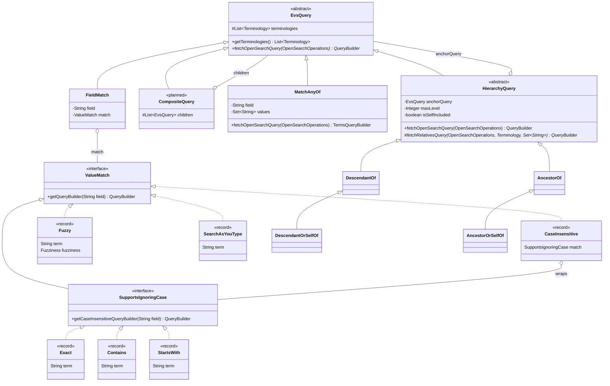

# EVS Query Tree

This package models a concept search as a tree of small query objects. Each node turns itself into
an OpenSearch `QueryBuilder`. Behavior is chosen by which classes you put in the tree (dynamic
dispatch), not by switching on a `type` string as `OpenSearchServiceImpl.getTermQuery` does.

There are two layers:

- **Queries** (`EvsQuery`) say which concepts match. `FieldMatch` is the leaf: it matches one
  concept field. Composite queries (planned) combine other queries with `and`, `or`, and so on.
  `FieldMatch` is for building nodes, not part of the API: it's package-private, and tests may
  only use it inside a class, method, or field marked `@DemonstratesFieldMatch` (enforced by
  `FieldMatchUsageSourceCodeTest`). Tutorials showing how to use the API must stick to the
  public nodes.
- **Value matches** (`ValueMatch`) say how one value is compared (exactly, by prefix, within a
  few edits, ...) without naming a field. A `FieldMatch` applies one to a concept field. A node
  that owns its own fields applies one to those, e.g. a relationship's type to the entry's type
  name and code.

Because every query has the same interface, any query can be nested inside any composite:

```lisp
(and (field "normName" (fuzzy "melanoma"))
     (or (field "code"     (exact "C3224"))
         (field "normName" (starts-with "blood"))))
```

## Logical operators: use raw OpenSearch for now

The plan is to build queries almost entirely from logical operator nodes (`And`, `Or`, `Not`,
`Boost`, and similar), with raw OpenSearch `QueryBuilder`s only inside the value matches. Those
nodes exist on a separate branch but **aren't tested yet, so don't build on them.**

Until they land, combine conditions inside your node's `fetchOpenSearchQuery` with raw OpenSearch
(`QueryBuilders.boolQuery()`, `nestedQuery`, `constantScoreQuery`, ...). Expect that code to be
refactored onto the logical nodes later. To keep that refactor mechanical:

- Build leaf conditions with `FieldMatch` and a value match (`Exact`, `StartsWith`, ...) and call
  its `fetchOpenSearchQuery`, rather than writing `termQuery`/`prefixQuery` by hand.
- Keep the raw combining code (`bool`, `must`, `should`, `must_not`, `constant_score`) in small,
  clearly named helpers, so each one maps onto a single logical node.

## Hierarchy



| Class | Role |
|---|---|
| `EvsQuery` | Base type for every query node. Its contract is `fetchOpenSearchQuery(operations)`. It also holds an unmodifiable copy of the terminologies being searched. Code that accepts a query should accept `EvsQuery`, so leaves and composites can be used interchangeably. |
| `FieldMatch` | The leaf query. It pairs a concept field with a `ValueMatch` and rejects `null` for either. It only says which field; the match says how. |
| `ValueMatch` | How one value is compared, with no field. Its contract is `getQueryBuilder(field)`. The implementations are records: plain values with no behavior beyond building their query. |
| `SupportsIgnoringCase` | A `ValueMatch` that can also ignore case: `Exact`, `StartsWith`, and `Contains`. `Fuzzy` doesn't, because OpenSearch has no case-insensitive fuzzy query. |
| `CaseInsensitive` | A wrapper match. It runs the wrapped match ignoring case by calling `getCaseInsensitiveQueryBuilder(field)`. The wrapped match is not changed. |
| `CompositeQuery` | Not implemented yet. A composite holds child `EvsQuery` nodes instead of a field and a match. |
| `MatchAnyOf` | A leaf matching a field against a set of values with one `terms` query: the many-value form of `FieldMatch` with `Exact`. Rejects more than 65,536 values, OpenSearch's default limit. |
| `HierarchyQuery` | Base type for hierarchy nodes. Runs the inner (anchor) query first through `declareDependencies`, then, for each terminology version, matches the anchors' relatives only in that terminology's index. Handles `maxLevel` (shortest distance, at least 1) and `isSelfIncluded`. Subclasses implement `fetchRelativesQuery`. |
| `DescendantOf` | Matches concepts strictly below the anchors, optionally within `maxLevel` levels. Any node can supply the anchors, including another hierarchy node. Terminologies with `ancestors`/`ancestorDepths` match with one query on those fields; older indexes fall back to the stored hierarchy (`StoredHierarchyFallback`, to be removed after reindexing). Convenience constructors take a code. |
| `DescendantOrSelfOf` | `DescendantOf` that also matches the anchors themselves (distance 0). |
| `AncestorOf` | The upward counterpart: matches concepts strictly above the anchors, optionally within `maxLevel` levels. Reads the anchors' stored paths to root (`StoredPaths`), which every index has, so there's no fallback and nothing to remove after reindexing. Nests with `DescendantOf`, e.g. siblings-or-self is `new DescendantOf(t, new AncestorOf(t, x, 1), 1)`. |
| `AncestorOrSelfOf` | `AncestorOf` that also matches the anchors themselves. |
| `RawBoolQueries` | The raw `bool` combining helpers (`getAllOfQuery`, `getAnyOfQuery`, `getMatchNothingQuery`) used until the logical operator nodes land; each maps onto `And`, `Or`, or `Not`. |

## Value matches

Apart from `SearchAsYouType`, the value matches are **case sensitive** and compare against the
**whole indexed value**. To ignore case, wrap one in `CaseInsensitive` (see below).
`SearchAsYouType` works on individual words and always ignores case.

| Record | Matches when the value… | OpenSearch query |
|---|---|---|
| `Exact` | equals the term exactly | `term` |
| `Contains` | includes the term anywhere | `wildcard` on `*term*`, with `*`, `?`, and `\` in the term escaped |
| `StartsWith` | begins with the term | `prefix` |
| `Fuzzy` | is within a small edit distance of the term (`Fuzziness.AUTO` by default, or pass one) | `fuzzy` |
| `SearchAsYouType` | contains every typed word in any order, with only the last word allowed to be partial. Ignores case. Needs a field mapped as `search_as_you_type` | `multi_match` of type `bool_prefix` over the field and its `._2gram` / `._3gram` subfields |

### Choosing a field

Whole-value matching only works on `Keyword` fields. On an analyzed `Text` field such as `name`,
OpenSearch stores lowercased tokens, so these matches compare individual words instead of the full
value.

Today **no field stores concept or synonym names in their original case**:

- `name` and `synonyms.name` are `Text`, so they're tokenized and lowercased.
- `normName` and `synonyms.normName` are `Keyword`, but `ConceptUtils.normalize` lowercases them
  and strips punctuation first.

So against current indexes, `Exact`, `Contains`, and the others are effectively case insensitive
on `normName`, and the term should be normalized the same way. True case-sensitive name matching
needs a keyword subfield (e.g. `name.keyword` via `@MultiField`, as `Mapping.source` does) and a
reindex.

Fields under `synonyms`, `definitions`, and `properties` are nested. Queries on them must be
wrapped in a `nestedQuery`, which is a natural job for a future `In` composite. It would own
the list's field paths and take a `ValueMatch` for each part of an entry.

### Usage

```java
final EvsQuery query = new FieldMatch(terminologies, "normName", new StartsWith("melan"));
boolQuery.must(query.fetchOpenSearchQuery(operations));
```

## Ignoring case

`CaseInsensitive` wraps a value match that implements `SupportsIgnoringCase`:

```java
// Finds "Melanoma", "melanoma", and "Malignant Melanoma"
final EvsQuery query =
    new FieldMatch(terminologies, "name", new CaseInsensitive(new Contains("MELANOMA")));
```

Case is a property of how a value is compared, so it goes on the match, not on a query. That
puts it on exactly one comparison.

The constructor only accepts matches that implement `SupportsIgnoringCase`, so
`new CaseInsensitive(new Fuzzy(...))` doesn't compile. To let a new match be wrapped, implement
`SupportsIgnoringCase` and return the same OpenSearch query with case ignored, usually by calling
`.caseInsensitive(true)` on the builder.

## Queries about other concepts (joins)

Some nodes hold a query that describes a different concept than the one being matched. For
example, a role's target: "primary site is Skin or anything below Skin" (spec 1.4). One OpenSearch
query only looks at one document, and a role entry only stores its target's code, so such a node
can't become one OpenSearch query.

**How it works:** building such a node runs the inner query first. `fetchOpenSearchQuery(operations)`
takes the OpenSearch operations so it can. The node calls `declareDependencies(operations,
dependencies...)`, which runs each dependency and pages through every matching concept with
`search_after` (sorted by code, then index, so pages don't overlap). It reads no stored documents,
which can be very large: each hit's code is its first sort value (read from doc values) and its
terminology version is that of the index it came from. It returns one `ConceptKeys` per dependency:
the codes found in each terminology version. The node then matches what it found, e.g. with a
`terms` query on codes. The paging is done by `EvsQuery.fetchConceptKeys`, which runs the node's own
`fetchOpenSearchQuery`, so a node is written once and works both as a search and as a dependency. An inner query can hold its own query about another
concept, which runs first in the same way, to any depth. Nodes that don't hold a query about
another concept ignore `operations`.

**Why `operations` is a parameter:** a static lookup hides which nodes search and makes tests
change global state; injecting it at construction means every tree containing a search needs it
just to be built. Taking it in `fetchOpenSearchQuery` keeps trees plain data, and lets unit tests pass a
mock (see `DeclareDependenciesTest`).

**Limits are the caller's:** how many codes the caller can match (one `terms` query accepts at most
65,536 by default) depends on how it uses them, so the node that matches them checks, not the
fetch.

## Hierarchy queries

`DescendantOf` and `AncestorOf` match concepts below or above anchor concepts (spec 1.3). The
`OrSelf` forms also match the anchors. Each takes either a code or an inner query that selects the
anchors, and an optional `maxLevel` (shortest distance, at least 1).

```java
// Everything below Neoplasm (C3262)
new DescendantOf(terminologies, "C3262");

// Neoplasm and its children only
new DescendantOrSelfOf(terminologies, "C3262", 1);

// Every ancestor of Malignant Neoplasm (C4872), along every path
new AncestorOf(terminologies, "C4872");

// Siblings of C4872, and C4872 itself: the children of its parents
new DescendantOf(terminologies, new AncestorOf(terminologies, "C4872", 1), 1);

// Below anything that is below C3262 (the inner query runs first, see above)
new DescendantOf(terminologies, new DescendantOf(terminologies, "C3262"));
```

Like any node, the result is one OpenSearch query, so it combines with other conditions:

```java
boolQuery.must(new DescendantOf(terminologies, "C3262").fetchOpenSearchQuery(operations));
```

## Extending

### Adding a value match

Add a record implementing `ValueMatch` (or `SupportsIgnoringCase`, if it can ignore case), and
build the OpenSearch query from the field it's given and its own components. For example, a
regular-expression match:

```java
package gov.nih.nci.evs.api.query;

import java.util.Objects;
import org.opensearch.index.query.QueryBuilder;
import org.opensearch.index.query.QueryBuilders;

/**
 * Matches values against a regular expression (case sensitive).
 *
 * @param term the regular expression the value must match
 */
public record Regex(String term) implements ValueMatch {

  /**
   * Instantiates a {@link Regex}.
   *
   * @param term the regular expression the value must match
   */
  public Regex {
    Objects.requireNonNull(term, "term");
  }

  /* see superclass */
  @Override
  public QueryBuilder getQueryBuilder(final String field) {
    return QueryBuilders.regexpQuery(field, term);
  }
}
```

It then works everywhere a value match does: `new FieldMatch(terminologies, "code", new
Regex("C12[0-9]+"))`.

### Adding a composite query

> Don't add `And`, `Or`, `Not`, or similar yourself: they're coming from a separate branch (see
> [Logical operators](#logical-operators-use-raw-opensearch-for-now)). This section describes how
> composites are meant to work.

Extend `EvsQuery` directly. A composite holds child nodes and combines their builders. It never
needs to know which concrete classes its children are. For example, `And`:

```java
package gov.nih.nci.evs.api.query;

import gov.nih.nci.evs.api.model.Terminology;
import java.util.List;
import org.opensearch.index.query.BoolQueryBuilder;
import org.opensearch.index.query.QueryBuilder;
import org.opensearch.index.query.QueryBuilders;

/** Matches when every child query matches. */
public class And extends EvsQuery {

  /** The child queries. */
  private final List<EvsQuery> children;

  /**
   * Instantiates an {@link And}.
   *
   * @param terminologies the terminologies being searched
   * @param children the queries that must all match
   */
  public And(final List<Terminology> terminologies, final List<EvsQuery> children) {
    super(terminologies);
    this.children = List.copyOf(children);
  }

  /* see superclass */
  @Override
  public QueryBuilder fetchOpenSearchQuery(final OpenSearchOperations operations) {
    final BoolQueryBuilder boolQuery = QueryBuilders.boolQuery();
    for (final EvsQuery child : children) {
      boolQuery.must(child.fetchOpenSearchQuery(operations));
    }
    return boolQuery;
  }
}
```

`Or` is the same with `should(...)` and `minimumShouldMatch(1)`. `Not` uses `mustNot(...)`.

Composites nest without any extra code:

```java
final EvsQuery query =
    new And(
        terminologies,
        List.of(
            new FieldMatch(terminologies, "normName", new Fuzzy("melanoma")),
            new Or(
                terminologies,
                List.of(
                    new FieldMatch(terminologies, "code", new Exact("C3224")),
                    new FieldMatch(terminologies, "normName", new StartsWith("blood"))))));
```

### Checklist for a new query

1. Name it after what it matches, and document that behavior in the class Javadoc.
2. Build an OpenSearch query in `fetchOpenSearchQuery(operations)` (a query) or
   `getQueryBuilder(field)` (a value match). Only run a search there for a query
   about another concept, through `declareDependencies` (see
   [Queries about other concepts](#queries-about-other-concepts-joins)).
3. Escape any characters in the term that are syntax for the OpenSearch query you use (see
   `Contains.escapeWildcards`).
4. If a value match's OpenSearch query supports ignoring case, implement `SupportsIgnoringCase`.
5. Add a lesson to `ValueMatchTest` (or a similar test) that runs the query against the test index
   and asserts which values it finds. Test behavior, not the built `QueryBuilder`.
6. Run `./gradlew spotlessApply`.
